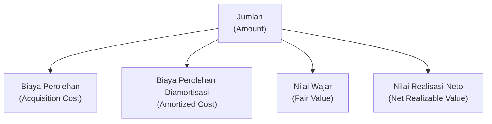
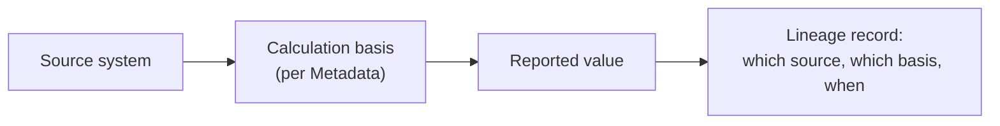

# Data Lineage

> The trail that connects a reported value back to where it actually came from.

---

# What Data Lineage Actually Answers

A regulator doesn't just want to know that a number is present and correctly formatted. When a figure looks wrong, or an examiner asks a bank to justify what it submitted, the question that follows is always the same: where did this number come from, and how was it calculated. Data lineage is what makes that question answerable.

Lineage traces a reported value back through every transformation it went through — from the source system where it was first recorded, through whatever calculation or aggregation produced the figure that ended up in a report. Without it, a value is just a number; with it, a value has a story that can be checked, defended, and reproduced.

---

# A Concrete Example: Why "Jumlah" Isn't Always Calculated the Same Way

BI-ANTASENA, Bank Indonesia's integrated reporting system, defines a field called "Jumlah" (Amount) that appears across many different report sections. Its definition makes clear that the same field name doesn't mean the same calculation every time — it depends on the underlying accounting basis for that particular instrument:

An asset measured at acquisition cost gets its "Jumlah" from a different calculation than one measured at amortized cost using the effective interest method, which is different again from one measured at fair value on the reporting date. All four are legitimate, and all four are governed by specific accounting standards (PSAK 16, PSAK 71, PSAK 68, and related standards, depending on the instrument).

This is exactly why lineage matters: two reports can both show a "Jumlah" of the same magnitude, produced by genuinely different calculations, from genuinely different source data. Without lineage recorded alongside the value, there's no way to know — from the number alone — which basis actually produced it.

---

# Tracing a Value Back to Its Origin

Lineage isn't only about which formula was used. It also traces a value back to the specific system, party, or authority that originated it in the first place.

Two examples from BI-ANTASENA make this concrete:

- **The reporting bank's own code** ("Sandi Bank Pelapor") isn't something a bank generates internally — its metadata definition states plainly that the code is assigned by Bank Indonesia itself. Lineage for this field doesn't trace back into the bank's own systems at all; it traces back to the regulator that issued the code.
- **A customer's tax identification number** (NPWP) has a lineage that changed over time along with the underlying identifier. BI-ANTASENA's own metadata now accepts either a 15-digit or 16-digit NPWP, reflecting Indonesia's transition to a 16-digit NIK-based tax ID format. A value captured before that transition and a value captured after it may both be labeled "NPWP," but they trace back through different source formats — which is exactly the kind of detail [Metadata](/knowledge/metadata) and lineage together need to preserve, not just the current value.

---

# Where Lineage Fits Alongside the Rest of Knowledge

Lineage depends on the same chain the rest of the [Knowledge](/knowledge) section describes: an obligation ([Regulatory Reporting](/knowledge/regulatory-reporting)) defines what must be reported, [Metadata](/knowledge/metadata) defines what a field means and how it's calculated, and [Reference Data](/knowledge/reference-data) constrains which values are valid. Lineage is what connects all of that back to an actual source system, on an actual date, for an actual reported value — the part of the story that makes a number defensible, not just correctly formatted.

This is also technical, not just regulatory, metadata: it's the trail an engineer or a data steward needs to trace or debug a value, as described in [Metadata](/knowledge/metadata)'s three-way distinction between business, technical, and regulatory metadata. Lineage is the fullest expression of technical metadata — it exists specifically so a value's origin can be reconstructed after the fact, not just described in the abstract.

---

# Related Documentation

- [Metadata](/knowledge/metadata) — the field definitions and calculation bases lineage traces back to.
- [Reference Data](/knowledge/reference-data) — the controlled values a traced field is expected to resolve against.
- [Data Quality](/knowledge/data-quality) — how a value's trustworthiness is checked, once its lineage is known.
- [Regulatory Reporting](/knowledge/regulatory-reporting) — the obligations that ultimately require a value to be traceable in the first place.
