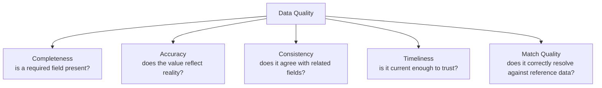
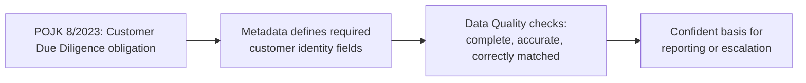
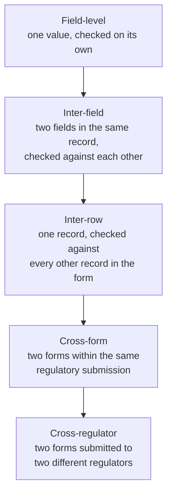

# Data Quality

> Whether a value is trustworthy enough to report — before a regulator has to ask.

---

# Why Data Quality Is a Regulatory Concern, Not Just a Technical One

It's easy to think of data quality as an engineering problem: missing values, mismatched types, duplicate records. In a regulatory reporting context, it's that too — but the stakes are different. A data quality failure here doesn't just break a dashboard; it can mean a suspicious transaction goes unreported, a sanctioned party goes unscreened, or a submission to a regulator turns out to be wrong.

POJK Nomor 8 Tahun 2023, OJK's regulation on anti-money laundering, countering the financing of terrorism, and countering the financing of weapons-of-mass-destruction proliferation, makes this concrete. It requires financial service providers to perform Customer Due Diligence — identifying, verifying, and monitoring customers so that transactions can be confirmed against a customer's profile and transaction pattern — and to report suspicious transactions to PPATK, Indonesia's financial intelligence unit. OJK sets the program requirement; PPATK is the regulator the resulting reports are actually submitted to. Customer Due Diligence is, at its core, a data quality obligation: it doesn't work if the underlying customer data is incomplete, stale, or wrong.

---

# What Data Quality Checks Actually Verify

The platform organizes data quality checks around a handful of recurring questions, each one metadata-driven rather than hardcoded per field.

**Completeness** — is a field that's required present at all? Under POJK 8/2023, a customer record missing identity or beneficial-owner information isn't just incomplete data; it's a Customer Due Diligence obligation that hasn't been satisfied.

**Accuracy** — does the value reflect reality, not just a plausible-looking format? A correctly formatted but wrong tax ID passes a syntax check and fails a data quality check.

**Consistency** — do related fields agree with each other? A transaction flagged as domestic that references a foreign counterparty bank is internally inconsistent, regardless of whether either field is individually valid.

**Timeliness** — is the value current enough to be trusted for the decision being made? Customer due diligence that hasn't been refreshed in years doesn't reflect a customer's current risk profile, even if it was accurate when captured.

**Match quality** — does a value correctly resolve against controlled reference data? This matters most acutely in sanctions and watchlist screening: does a customer name correctly match, or fail to match, an entry on a list like the DTTOT (List of Suspected Terrorists and Terrorist Organizations) or DPPSPM (List of Suspected Proliferation Financing)? A false negative here isn't a data quality nuisance — it's a missed obligation to escalate.

---

# A Concrete Example: Customer Due Diligence Data Quality

POJK 8/2023 requires financial service providers to identify and verify a customer's identity, and to monitor transactions against that customer's known profile. Each part of that obligation implies a specific data quality check:

If a customer's identity data fails a completeness or accuracy check, that's a signal the underlying Customer Due Diligence hasn't actually been completed — not just a data problem to clean up before reporting, but a compliance gap the data quality check exists to surface.

---

# How Data Quality Checks Are Driven by Metadata, Not Hardcoded

A data quality check that's hardcoded per field breaks the moment a regulation changes what a field means, how it's formatted, or which reference data it draws on. The platform instead drives its data quality checks from the same [Metadata](/knowledge/metadata) that describes the field in the first place.

This is what [metadata-driven validation](/patterns/metadata-driven-validation) means in practice: a completeness rule doesn't need to be told "this field is required" in code — it reads that requirement from the field's own metadata, the same metadata RRDF's canonical model and CDAP's compiled validation logic already reference.

---

# Various Validation Requirements for Regulatory Reporting

Not every validation rule looks the same, and not every rule can run at the same point in the reporting lifecycle. What a regulation mandates can require checking a single field, comparing a field against another field in the same record, comparing a record against every other record in the same form, comparing one form against another within the same regulator's submission, or comparing forms submitted to two entirely different regulators. CRRR's output needs to capture all of these, not just the simplest case.

**Field-level** — a single value, checked on its own: is it present, correctly formatted, and does it correctly resolve against reference data. This is the completeness, accuracy, and match-quality checking described earlier on this page, and it can run as soon as a value is captured.

**Inter-field** — two fields within the same record, checked against each other for logical consistency. A maturity date that falls before its own start date is invalid regardless of whether either date, on its own, is well-formed. This still only requires a single record, but it requires more than one field of it.

**Inter-row** — a single record, checked against every other record already collected in the same form. Uniqueness is the clearest example: in Antasena-dep01 (deposits), an account number must be unique across the form. This can't be checked field by field as data arrives — it requires the rest of the rows to exist first, because the thing being verified is a relationship across rows, not a property of any one row.

**Cross-form** — two forms within the same regulatory submission, checked against each other. The total in Antasena-tab01 (savings accounts), broken down by currency and other regulator-mandated dimensions, must reconcile against the liabilities section of Antasena-lrg01. Both forms are submitted to the same regulator, Bank Indonesia, as part of the same integrated reporting system (BI-ANTASENA), so this check stays within a single regulatory relationship.

**Cross-regulator** — two forms submitted to two different regulators entirely, checked against each other. Antasena-krp01 is submitted to Bank Indonesia through BI-ANTASENA; SLIK-F01 is submitted to OJK through its own separate system. Cross-validating these two isn't just a bigger version of the cross-form case — it means reconciling data across two independent regulatory relationships, each with its own submission channel and format.

Cross-regulator validation isn't universal, though — it depends on whether the regulators involved actually require it. Suspicious transaction and cash transaction reports submitted to PPATK, Indonesia's financial intelligence unit, under the AML/CFT program described earlier on this page, don't currently need to reconcile against Antasena or SLIK; that reporting stands on its own. Whether a given pair of obligations needs cross-regulator validation is itself something CRRR has to capture explicitly, not something the platform can assume by default.

This category is also where the platform needs room to grow. LPS (Indonesia's deposit insurance corporation, analogous to the FDIC in the United States) doesn't currently require banks to cross-check Antasena-tab01, Antasena-gir01, and Antasena-dep01 against its own records — but since these are exactly the accounts LPS insures, a future obligation to reconcile insured-fund totals across BI-ANTASENA and an LPS-specific report is plausible. Capturing cross-regulator relationships as metadata, rather than hardcoding today's known pairs, is what would let that kind of obligation be added later without redesigning how validation works.

Because inter-row, cross-form, and cross-regulator checks all depend on data that doesn't exist yet at the point an individual field is captured, they necessarily run later in the reporting lifecycle — after enough of a form, or an entire report, has been assembled — rather than at the point of data entry. The platform's [metadata-driven validation](/patterns/metadata-driven-validation) applies to all five kinds the same way: which fields are compared, which rows must be unique, and which forms or reports must reconcile against which — within one regulator's submission or across two — is itself metadata captured once in CRRR, not a hardcoded rule written specifically for Antasena-dep01 or Antasena-tab01.

---

# Where Data Quality Fits in the Reporting Lifecycle

Every validation category described above depends on everything that comes before it in the [Knowledge](/knowledge) chain: an obligation ([Regulatory Reporting](/knowledge/regulatory-reporting)) defines what must be captured, [Metadata](/knowledge/metadata) defines what a field means and requires, and [Reference Data](/knowledge/reference-data) supplies the controlled values a field is checked against. Whether the check runs on a single value, a pair of fields, a full form, two forms within one regulator's submission, or forms spanning two different regulators, it's this same underlying knowledge — captured once — that determines what "trustworthy enough to submit" actually means.

---

# Related Documentation

- [Metadata](/knowledge/metadata) — the field-level definitions data quality checks are driven by.
- [Reference Data](/knowledge/reference-data) — the controlled vocabularies match-quality checks rely on.
- [Metadata-Driven Validation](/patterns/metadata-driven-validation) — how CDAP compiles data quality rules from metadata instead of hardcoding them.
- [Knowledge](/knowledge) — how data quality relates to the other Knowledge topics.
