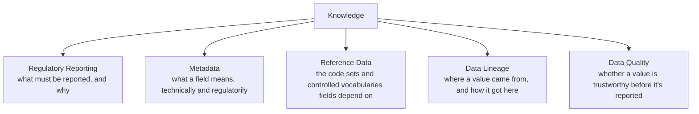
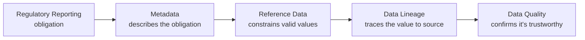

# Knowledge

> The regulatory knowledge that everything else in the platform depends on, explained.

---

# What This Section Covers

The [Knowledge Layer](/platform/knowledge-layer) is where the platform captures and governs regulatory knowledge — but a layer diagram only tells you *that* it exists. This section explains *what* that knowledge actually consists of, topic by topic.

Each page here covers one concern the Knowledge Layer is responsible for: the metadata that makes data explainable, the reference data that gives fields their controlled vocabularies, the lineage that traces a value back to its source, the quality checks that catch bad data before it reaches a report, and the regulatory reporting obligations that drive all of it in the first place.

None of this is documentation written to be read once and forgotten. Every topic below is captured as structured, governed metadata in CRRR, and consumed directly by the rest of the platform — RRDF, CDAP, CRTP, and the solutions built on them.

---

# Topics in This Section

**[Regulatory Reporting](/knowledge/regulatory-reporting)** — the obligations a regulation imposes: what must be submitted, in what form, on what schedule, and under whose authority. This is the starting point most other Knowledge topics ultimately trace back to.

**[Metadata](/knowledge/metadata)** — the business, technical, and regulatory context that makes a data element explainable: what it means, where it lives, and which rule governs it.

**[Reference Data](/knowledge/reference-data)** — the code sets and controlled vocabularies — currency codes, entity types, transaction classifications, and the like — that give many metadata fields their valid values.

**[Data Lineage](/knowledge/data-lineage)** — the technical trail that connects a reported value back to the source system and transformation steps that produced it.

**[Data Quality](/knowledge/data-quality)** — the checks that confirm a value is fit to report before it reaches a regulator, and what happens when it isn't.

---

# How These Topics Relate

These aren't five independent concerns — they build on each other in a fairly natural order.

A regulation imposes a **reporting** obligation. That obligation is described using **metadata** — field definitions, formats, effective dates. Many of those fields draw their valid values from **reference data** — controlled code sets rather than free text. Every value that ends up in a report can be traced back through **lineage** to the source system it came from. And before any of it is submitted, **data quality** checks confirm the value is actually trustworthy.

A change at any point in this chain is expected to propagate through the rest of it — a new reporting obligation typically means new metadata, which may draw on new reference data, and all of it needs to be traceable and quality-checked the same way existing fields already are.

---

# Where This Knowledge Is Used

Everything in this section is captured once, in CRRR, and consumed by the rest of the platform rather than copied into each consuming system:

- **RRDF** builds its canonical models from the metadata and reference data described here.
- **CDAP** compiles this knowledge into machine-readable regulatory assets that an execution engine can consume.
- **CRTP** uses the same knowledge to generate the Golden Test Data that confirms an execution engine implements it correctly.
- **CRRS**, and other solutions like GX Validation Engine, consume what CDAP and CRTP produce, without needing to understand the underlying regulation themselves.

See [Platform Architecture](/platform/architecture) for how these layers fit together, and [Solutions Layer](/platform/solutions-layer) for how a solution actually uses what CRRR captures here.

---

# Related Documentation

- [Knowledge Layer](/platform/knowledge-layer) — the platform layer this section explains in detail.
- [Platform Architecture](/platform/architecture) — how Knowledge fits with Information, Execution, and Solutions.
- [Metadata-Driven Validation](/patterns/metadata-driven-validation) — how execution reads this knowledge to validate without hardcoded rules.
- [Metadata-Driven Processing](/patterns/metadata-driven-processing) — how this knowledge drives transformation and processing logic.
