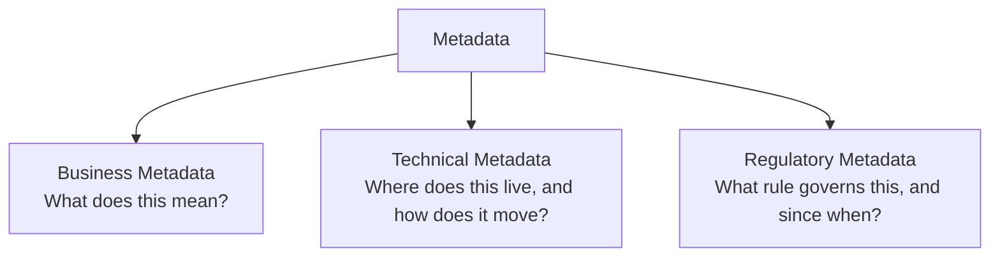
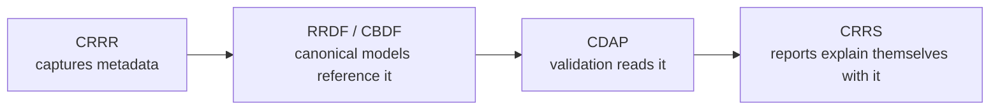

# Metadata

> Data about data — and the layer that makes everything else in the platform explainable.

---

# Why Metadata Gets Its Own Category

Most reporting systems treat metadata as an afterthought: a few configuration tables, some column comments, a data dictionary that goes stale within a quarter.

The platform treats metadata as a first-class, governed asset — because metadata is what turns a canonical data model or a validation rule from an opaque artifact into something a person, an auditor, or an AI system can actually explain.

Without metadata, a validated report is just a set of numbers. With metadata, every number can answer three questions: *where did this come from, what does it mean, and which rule says it has to look like this.*

---

# Three Kinds of Metadata

The platform distinguishes three categories of metadata, each answering a different question.

**Business metadata** — the human meaning of a data element: definitions, business terms, ownership, and the plain-language description a compliance officer or auditor would recognize. This is what makes a field like `asset_under_custody_value` legible to someone who isn't reading the schema.

**Technical metadata** — the structural and operational facts about a data element: its data type, source system, transformation lineage, storage location, and how it moves through pipelines. This is what an engineer or a data steward needs to trace or debug a value.

**Regulatory metadata** — the compliance context: which regulation or obligation a field or rule implements, its effective and expiry dates, applicable jurisdiction, and version history. This is what an auditor needs to confirm a report was correct *as of* the reporting date, not just correct today.

A single data element typically carries all three. A field isn't just `decimal(18,2)` (technical) — it's also "Nilai Asset Under Custody" (business) and "required under POJK Nomor 24/POJK.04/2017 on Laporan Bank Umum sebagai Kustodian, monthly submission due 12 days after period-end" (regulatory).

---

# Where Metadata Lives in the Platform

Metadata isn't stored as documentation — it's stored as structured, queryable records that other platform components consume directly, the same way [Knowledge Layer](/platform/knowledge-layer) content is captured once and referenced everywhere.

CRRR is where business and regulatory metadata originate — a subject matter expert defines a term or maps a field to an obligation once. RRDF and CBDF's canonical models carry that metadata forward as structural definitions. CDAP's execution services read metadata at runtime to drive [metadata-driven validation](/patterns/metadata-driven-validation) and [metadata-driven processing](/patterns/metadata-driven-processing) rather than hardcoding field-level logic. CRRS surfaces that same metadata back to end users, so a generated report can explain, field by field, what a value means and which rule produced it.

---

# Why This Matters: Explainability

A validation failure or a report figure is only useful if someone can understand why it looks the way it does. Metadata is what makes that possible without a developer opening source code.

- A **business user** sees the plain-language meaning of a field.
- An **auditor** sees the regulatory basis and effective date for a rule.
- An **engineer** sees the technical lineage back to source.

This is the same explainability that [GoDQ relies on](/products/crrs/architecture) when it produces explainable validation results — the explanation exists because the metadata backing it was captured up front, not reconstructed after the fact.

---

# Governance

Like the rest of the Knowledge Layer, metadata is versioned, owned, and reviewed rather than edited freely:

- **Versioned** — changes to a term, mapping, or classification are tracked over time, not overwritten.
- **Owned** — each metadata asset has a named steward accountable for its accuracy.
- **Reviewed** — changes to business or regulatory metadata go through review before they propagate downstream.

This is what allows validation results and generated reports to cite metadata as authoritative, rather than as a convenience layer that might be out of date.

---

# Related Documentation

- [Knowledge Layer](/platform/knowledge-layer) — the platform layer metadata belongs to.
- [Metadata-Driven Validation](/patterns/metadata-driven-validation) — how execution reads metadata to validate without hardcoded rules.
- [Metadata-Driven Processing](/patterns/metadata-driven-processing) — how metadata drives transformation and processing logic.
- [Data Lineage](/knowledge/data-lineage) — how technical metadata traces a value back to its source.
- [Reference Data](/knowledge/reference-data) — the code sets and controlled vocabularies that business metadata often depends on.
