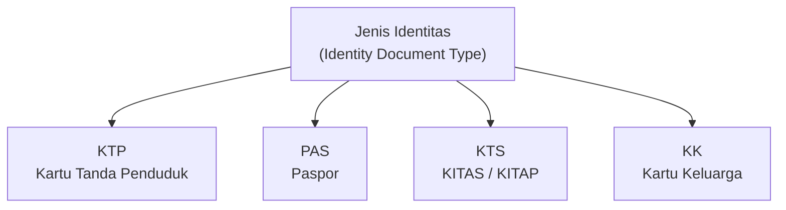
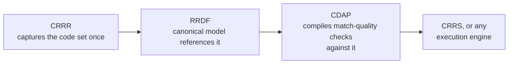

# Reference Data

> The controlled vocabularies that give a field its valid values.

---

# What Reference Data Actually Is

A field's [metadata](/knowledge/metadata) tells you what a value means and how it's formatted. It doesn't, on its own, tell you which specific values are allowed. That's the job of reference data: the code sets, classifications, and controlled vocabularies a field is permitted to draw from.

Without reference data, a field like "transaction category" is just free text — anyone reporting could write "joint," "shared," "two-party," or "multi," and mean the same thing four different ways. With reference data, the regulator's own defined categories are the only valid answers, and every report means the same thing by the same word.

---

# A Concrete Example: BI-ANTASENA's Identity Document Codes

Bank Indonesia's BI-ANTASENA — the integrated reporting system most Indonesian banks first think of when they think of regulatory reporting — publishes its reference data the same way: as controlled code sets, not free text. One of the simplest is the "Jenis Identitas" (identity document type) reference table, which governs what counts as valid identification for a reported party.

Each code is tied to the specific law that defines it: **KTP** (national identity card) traces to Indonesia's population administration law; **PAS** (passport) and **KTS** (limited or permanent stay permit) trace to the immigration law and its implementing regulation. A bank can't report a party's identity document as "ID card" or "national ID" and expect it to be understood the same way as KTP — the accepted values are exactly these codes, tied to exactly these legal definitions, and nothing else.

This is one table among many. BI-ANTASENA's reference data spans dozens of similar code sets — country codes, counterparty classifications, asset quality ratings, relationship-to-reporting-bank categories, and more — each governing what a specific field is allowed to contain.

---

# Why Reference Data Has to Be Centralized

If the Jenis Identitas code set were hardcoded separately into every system that touches an Antasena report — the acquisition pipeline, the validation logic, the report generator — a change to that code set would mean finding and updating every copy. Worse, two systems could silently drift out of sync, one still accepting a value the other now rejects.

The platform captures a code set like Jenis Identitas once, in CRRR, as governed reference data. RRDF's canonical model references that code set rather than repeating it. CDAP compiles the match-quality checks described on the [Data Quality](/knowledge/data-quality) page from the same source. If Bank Indonesia ever changes or extends the code set — and BI-ANTASENA's own version history shows this happens regularly, with new codes added or definitions adjusted by official circular letter — the update happens once, in CRRR, and propagates outward, the same principle behind everything else in the [Knowledge Layer](/platform/knowledge-layer).

---

# Reference Data Spans Multiple Regulators

Reference data isn't a single shared list the platform maintains once for every purpose — each regulator defines and owns its own code sets, for its own reports. A code set defined for a Bank Indonesia report shouldn't be assumed to apply to an OJK report, even where the underlying concept looks similar; PPATK's classifications for its own AML/CFT reports are governed separately again.

This means CRRR has to capture reference data as belonging to a specific obligation and a specific regulator, not as one universal dictionary. A platform built to serve multiple regulators — as described in [Regulatory Reporting](/knowledge/regulatory-reporting) — depends on this distinction holding up: each regulator's code sets need to be captured, governed, and versioned independently, even when two regulators happen to use similar-sounding terms for different things.

---

# Related Documentation

- [Metadata](/knowledge/metadata) — how a field's meaning and format are defined, separately from which values it accepts.
- [Data Quality](/knowledge/data-quality) — how match-quality checks confirm a value correctly resolves against reference data.
- [Regulatory Reporting](/knowledge/regulatory-reporting) — the obligations that reference data ultimately serves.
- [Knowledge Layer](/platform/knowledge-layer) — the platform layer that captures reference data as governed metadata.
