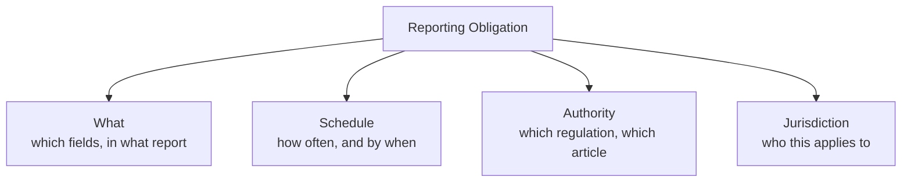
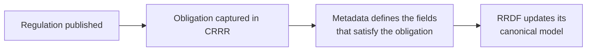

# Regulatory Reporting

> The obligation everything else in the Knowledge section ultimately traces back to.

---

# What a Reporting Obligation Actually Is

Before a field can have metadata, before a value can have lineage, before anything can be validated — there has to be an obligation to report something in the first place.

A regulatory reporting obligation is the answer to a small set of questions a regulator has already answered on a bank's behalf: what must be submitted, in what form, on what schedule, and under what authority. Everything else the Knowledge section describes exists to satisfy this obligation correctly.

A single regulation can impose one obligation or many. POJK Nomor 24/POJK.04/2017, for example, imposes two distinct reporting obligations on commercial banks acting as custodians: a monthly activity report covering securities recorded during the period, and an annual report based on a public accountant's operational review — each with its own content, and its own deadline.

---

# The Anatomy of an Obligation

The platform captures a reporting obligation as a structured record in CRRR, not as a paragraph of prose. That record typically answers:

**What** — the specific content the report must contain, down to the field level. This is what [Metadata](/knowledge/metadata) describes in detail once the obligation has been captured.

**Schedule** — how often the report is due, and the deadline relative to the reporting period. POJK 24/POJK.04/2017's monthly custodian report, for instance, is due no later than 12 days after the period ends; its annual report is due within 90 days of the annual period ending.

**Authority** — the specific regulation, and often the specific article or provision, that imposes the obligation. This is what lets an auditor confirm a report exists *because* a named rule requires it, not because someone decided it seemed prudent.

**Jurisdiction** — who the obligation applies to. A custodian reporting obligation under Indonesian financial services regulation applies to commercial banks acting as custodians specifically, not to every bank the platform might one day serve.

---

# From Obligation to Metadata

An obligation on its own doesn't tell an engineer what column to build or an auditor what a field means — it tells CRRR *that* something must be captured. Turning "banks must report the value of assets under custody monthly" into an actual field, with a name, a type, and a plain-language definition, is the job of [Metadata](/knowledge/metadata).

This is also where a regulatory change most often originates. When a regulator changes what must be reported — a new field, a changed format, a new deadline — that change is captured here first, as an update to the obligation, before it propagates into metadata and the canonical models built on it.

---

# Why Capturing the Obligation Matters

A report that satisfies a regulator's requirements today can silently stop doing so the moment the regulator changes what's required — a new deadline, a redefined field, a jurisdiction that now applies differently. If the obligation itself isn't captured as a first-class, versioned record, that kind of drift can go unnoticed until an examiner asks why a submission doesn't match current expectations.

Capturing the obligation explicitly is what lets the platform answer, for any given report: which regulation requires this, has that regulation changed since we last reported, and is what we're about to submit still correct as of today's rules.

---

# Related Documentation

- [Metadata](/knowledge/metadata) — how an obligation becomes a defined, explainable field.
- [Knowledge Layer](/platform/knowledge-layer) — the platform layer that captures reporting obligations as structured metadata.
- [Knowledge](/knowledge) — how reporting obligations relate to the other Knowledge topics.
