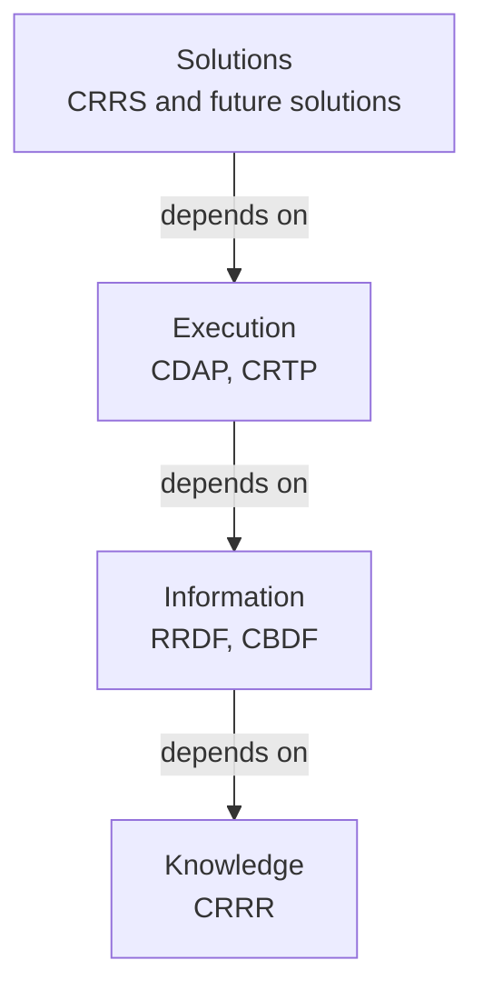
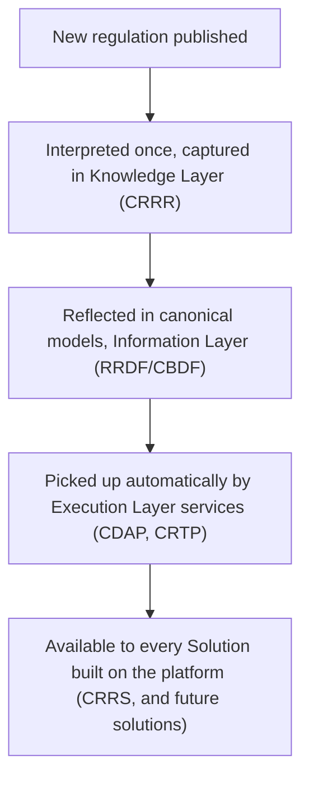

# Platform Architecture

> How the four layers of CygnetONE fit together.

---

# Starting Point

A platform is not defined by the products it contains, but by the architecture that connects them.

CygnetONE's architecture exists to answer one question: how do you let many different applications share the same regulatory knowledge, without duplicating it?

The answer is a layered architecture, where each layer has a single responsibility and depends only on the layer beneath it.

---

# The Layer Stack

Knowledge sits at the bottom because everything above it depends on it.

Solutions sit at the top because they are what customers actually use.

Each layer can evolve independently, as long as it honors the contract of the layer beneath it.

---

# Knowledge Layer

**Responsibility:** capture and govern regulatory knowledge as structured metadata.

This layer holds regulatory publications, reporting requirements, validation rules, business terminology, and reference data — not as documentation, but as machine-readable, version-controlled metadata.

**Primary product:** CRRR (Compliance Requirements & Regulatory Repository).

**Consumed by:** every layer above it.

See [Knowledge Layer](/platform/knowledge-layer) for detail.

---

# Information Layer

**Responsibility:** transform regulatory concepts into canonical business information models.

Knowledge is only useful if it can be represented consistently. This layer defines information models that are independent of any single operational source system, so that reporting, validation, and analytics all work from the same definitions.

**Primary products:** RRDF (Regulatory Reporting Data Foundation), CBDF (Cygnet Banking Data Foundation).

**Depends on:** Knowledge Layer.

**Consumed by:** Execution and Solution layers.

See [Information Layer](/platform/information-layer) for detail.

---

# Execution Layer

**Responsibility:** provide reusable services that act on knowledge and information.

This layer runs the actual work — validation, transformation, workflow orchestration, and regression testing — as shared platform services rather than one-off code inside each application.

**Primary products:** CDAP (Compliance Data Asset Platform), CRTP (Compliance Regression Testing Platform).

**Depends on:** Knowledge and Information layers.

**Consumed by:** Solutions.

See [Execution Layer](/platform/execution-layer) for detail.

---

# Solution Layer

**Responsibility:** assemble platform capabilities into a complete business application.

Solutions are what customers deploy. Each one draws on shared knowledge, information models, and execution services rather than reimplementing them.

**First solution:** CRRS (Cygnet Regulatory Reporting Solution).

**Depends on:** all layers beneath it.

---

# How a Regulatory Change Flows Through the Stack

Because knowledge is captured once at the bottom of the stack, a single update propagates upward instead of requiring parallel changes in every application.

---

# Execution Technology Is Interchangeable

The Execution Layer is intentionally decoupled from any specific execution technology. Today's services may run on tools such as Great Expectations, dbt, Apache Airflow, Oracle, Temenos, or GoReport. Tomorrow's tools may be different.

Because knowledge and information are represented independently of execution technology, the platform can adopt new execution engines without re-deriving the underlying regulatory knowledge.

---

# Architectural Principles Applied

This layering is a direct expression of the principles described in the [Philosophy](/philosophy) collection:

- Knowledge before execution
- Metadata over hard-coded logic
- Separation of knowledge and execution
- Canonical information models
- Explainability by design
- Traceability across the lifecycle
- Compliance by construction
- Open architecture
- Version everything

---

# Why This Matters

A layered, metadata-driven architecture lets CygnetONE do three things traditional regulatory software cannot do easily:

- Update regulatory logic in one place instead of many.
- Add new execution engines or solutions without rebuilding the knowledge base.
- Give every consuming application — reporting, validation, testing, or AI — a single, traceable source of truth.

This is what makes "Knowledge Once. Execution Everywhere." an architectural commitment rather than a slogan.
