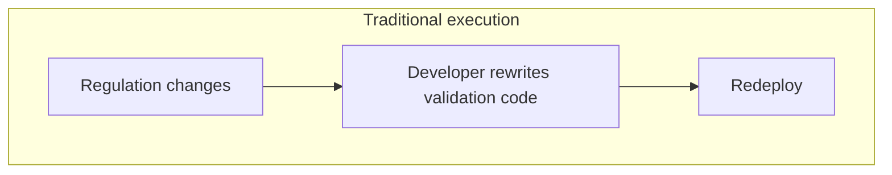
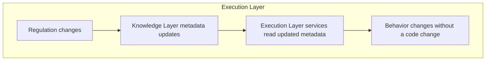

# Execution Layer

> Where knowledge and information get put to work.

---

# Purpose

Knowledge and canonical information models are only useful once something acts on them.

The Execution Layer provides the reusable platform services that consume the Knowledge and Information layers to actually do work: validating data, transforming it, orchestrating workflow, and testing that everything still behaves correctly as regulations and systems change.

---

# What Lives Here

The Execution Layer provides:

- Metadata-driven data validation
- Data transformation
- Workflow orchestration and automation
- Regression testing

Rather than building these capabilities separately inside every application, the platform provides them once, as shared services that any solution can call on.

---

# Primary Products: CDAP and CRTP

**CDAP — Compliance Data Asset Platform** provides the core execution services: validation, transformation, and workflow orchestration, all driven by the metadata defined in the Knowledge and Information layers rather than hard-coded logic.

**CRTP — Compliance Regression Testing Platform** ensures that as regulatory knowledge, canonical models, or execution technology change, existing behavior can be verified automatically instead of retested manually.

Together, they turn static knowledge and models into running, verifiable processes.

---

# Metadata-Driven, Not Hard-Coded

The defining characteristic of this layer is that its services are configured by metadata, not rewritten in code, when requirements change.

This is what allows the platform to keep pace with regulatory change without a full development cycle for every update.

---

# Execution Technology Is Interchangeable

The Execution Layer is deliberately decoupled from any single execution technology. Services in this layer may run on tools such as Great Expectations, dbt, Apache Airflow, Oracle, Temenos, or GoReport today — and on different tools tomorrow.

Because the knowledge and canonical models these services consume live in the layers below, the platform can swap execution technology without re-deriving the underlying regulatory logic.

---

# Relationship to Other Layers

- **Depends on:** the Knowledge Layer (for the rules and definitions it executes) and the Information Layer (for the canonical models it operates against).
- **Consumed by:** Solutions, which assemble Execution Layer services into complete applications.

See [Architecture](/platform/architecture) for how this fits into the full stack.

---

# Regression Testing as a First-Class Concern

Regulatory platforms change constantly — new regulations, updated interpretations, new source systems, new execution technology. Every one of those changes risks breaking something that used to work.

CRTP treats this as a first-class platform concern rather than an afterthought: known-good behavior is captured once and re-verified automatically whenever knowledge, models, or execution technology change, rather than relying on manual retesting.

---

# Why It Matters

Without a shared Execution Layer, every solution built on the platform would need to reimplement its own validation, transformation, workflow, and testing logic — duplicating effort and risking inconsistency between solutions.

With it, every solution inherits the same execution capabilities, configured by the same governed knowledge and models, so that behavior stays consistent and regulatory change only has to be handled once.
