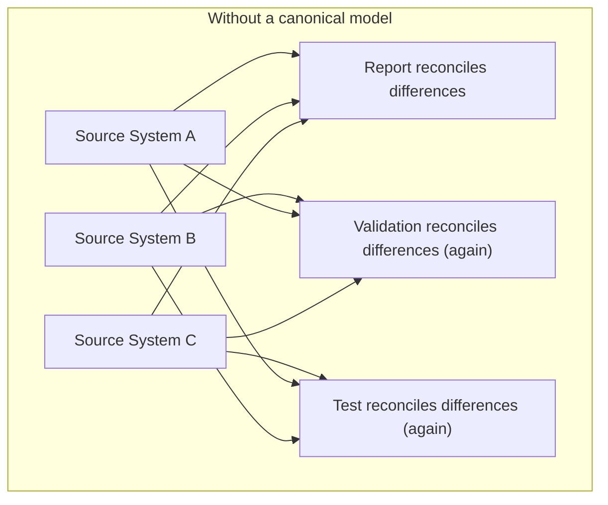
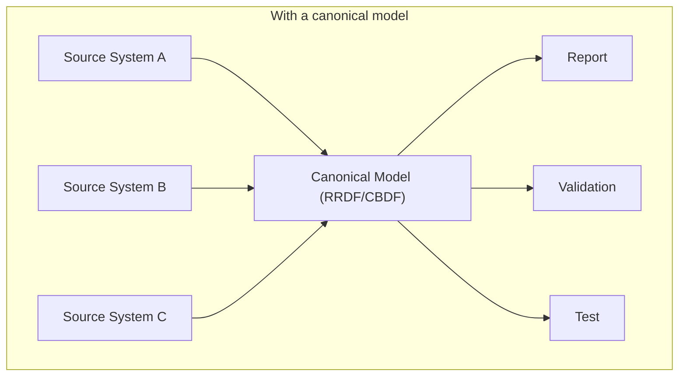
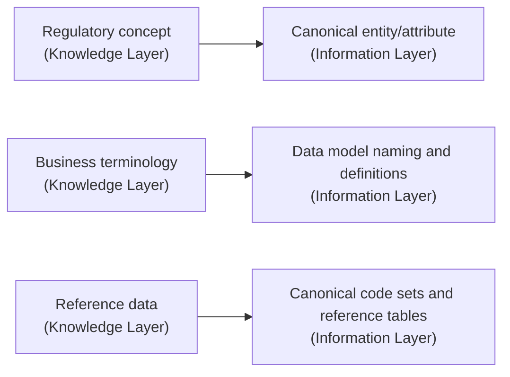

# Information Layer

> Where regulatory knowledge becomes consistent, usable data.

---

# Purpose

Knowledge becomes valuable only when it can be represented consistently.

The Information Layer transforms the regulatory concepts captured in the Knowledge Layer into canonical business information models — models that are independent of any particular operational source system.

These models are the stable foundation that reporting, validation, analytics, and integration are all built on.

---

# The Problem It Solves

Every bank has multiple core systems, each with its own way of representing the same underlying concept. A "customer," a "facility," or an "exposure" may be structured differently in three different source systems.

Without a canonical model, every downstream process — every report, every validation rule, every test — has to independently reconcile these differences. That reconciliation logic gets duplicated everywhere it's needed, and drifts out of sync over time.

The Information Layer removes that duplication by defining the canonical shape once.

---

# Primary Products: RRDF and CBDF

**RRDF — Regulatory Reporting Data Foundation** defines canonical models for the data that regulatory reports are built from: the entities, attributes, and relationships that reporting obligations reference.

**CBDF — Cygnet Banking Data Foundation** extends this to a broader canonical model of core banking data, providing the shared vocabulary that RRDF and other platform components build on.

Together, they give every consuming process — reporting, validation, transformation, testing — a single, agreed definition of what the data means.

---

# How It Relates to the Knowledge Layer

The Information Layer does not invent its own definitions. It implements, in structured data-model form, the business concepts and terminology already captured in the Knowledge Layer (CRRR).

This keeps the two layers in sync: when a regulatory definition changes in the Knowledge Layer, the Information Layer is where that change gets reflected structurally.

---

# Design Principles

The canonical models in this layer are built to be:

- **Source-independent** — modeled around the business concept, not around any one operational system's schema.
- **Stable** — designed to change only when the underlying regulatory or business concept changes, not when a source system is replaced.
- **Explicit** — every attribute has a traceable definition back to the Knowledge Layer.
- **Reusable** — the same model serves reporting, validation, analytics, and integration without modification.

---

# Relationship to Other Layers

- **Depends on:** the Knowledge Layer, for the concepts and terminology it models.
- **Consumed by:** the Execution Layer, whose services (CDAP, CRTP) operate against these canonical models rather than against raw source-system data.
- **Consumed by:** Solutions, indirectly, through the Execution Layer.

See [Architecture](/platform/architecture) for the full picture of how the layers connect.

---

# Why It Matters

Without a canonical information layer, every new report, validation rule, or integration has to re-derive its own understanding of the underlying data — repeating work that has already been done elsewhere in the organization, and introducing the risk that different teams define the same concept differently.

With it, the organization gets one place where "what does this data mean" is answered — consistently, for every consumer, for as long as the platform is in use.
