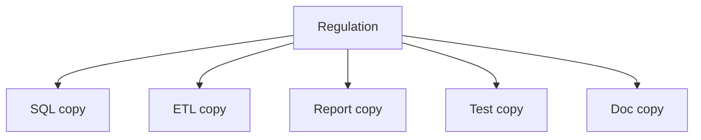
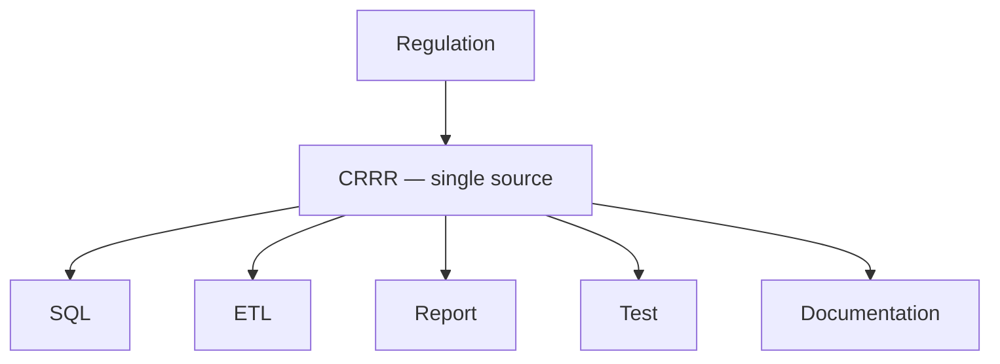

# Knowledge Layer

> The foundation everything else in the platform builds on.

---

# Purpose

The Knowledge Layer captures and governs regulatory knowledge.

It exists because regulatory knowledge is usually the least visible, least reusable asset inside a financial institution — buried in PDFs, spreadsheets, application code, and the heads of a small number of subject matter experts.

The Knowledge Layer makes that knowledge explicit, structured, and reusable.

---

# What Lives Here

The Knowledge Layer represents:

- Regulatory publications and their source references
- Reporting requirements, obligation by obligation
- Validation and business rules
- Business terminology and definitions
- Reference data and code sets
- Regulatory metadata — versioning, effective dates, jurisdiction, applicability

None of this is stored as documentation for humans to read once and forget. It is stored as structured, version-controlled metadata that downstream systems can consume directly.

---

# Primary Product: CRRR

CRRR — the Compliance Requirements & Regulatory Repository — is the platform component that implements the Knowledge Layer.

CRRR is where a regulation is interpreted once, by a subject matter expert, and captured in a form that can be reused by every other layer of the platform.

---

# Why Knowledge, Not Application Logic

Traditional regulatory technology embeds business rules directly inside SQL, ETL jobs, and reporting applications. Each embedding is a separate copy of the same knowledge.

The Knowledge Layer inverts this. A rule is captured once, in one place, and referenced — not copied — by whatever needs it.

**Traditional approach** — the regulation is copied into every place that needs it:

**Knowledge Layer approach** — the regulation is captured once, and every consumer references that single source:

Six places to update when the regulation changes, versus one.

---

# Governance

Knowledge in this layer is not static. Regulations change, interpretations get refined, and reference data gets superseded.

The Knowledge Layer treats every piece of regulatory knowledge as a versioned, owned, reviewable asset:

- **Versioned** — every change is tracked, with effective and expiry dates.
- **Owned** — each knowledge asset has a named owner responsible for its accuracy.
- **Reviewable** — changes go through review before they propagate to consuming systems.
- **Traceable** — every downstream artifact can be traced back to the regulatory source it implements.

This governance discipline is what lets the rest of the platform trust the Knowledge Layer without re-verifying it at every layer above.

---

# Relationship to Other Layers

The Knowledge Layer is the only layer with no dependency on anything above it — everything else in the platform depends on it.

- The **Information Layer** turns knowledge concepts into canonical data models.
- The **Execution Layer** consumes knowledge to drive validation, transformation, and testing.
- **Solutions** inherit knowledge indirectly, through the Information and Execution layers.

See [Architecture](/platform/architecture) for how the full stack fits together.

---

# Why It Matters for AI

Structured regulatory knowledge is also what makes AI-assisted compliance work reliably.

Large language models are effective at interpreting structured information, but inconsistent and hard to verify without it. A well-governed Knowledge Layer gives AI applications — regulation interpretation, impact analysis, rule explanation, knowledge search — a trustworthy foundation to reason over, instead of raw, unstructured documents.

---

# Summary

The Knowledge Layer is where the platform's core belief becomes concrete: regulatory knowledge is an enterprise asset, not application logic.

Everything else the platform does — building canonical data models, running validation, generating reports, powering AI assistants — depends on knowledge captured once, here, and reused everywhere else.
