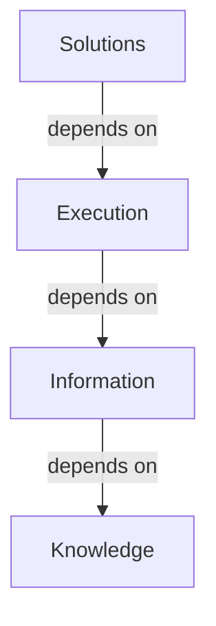

# Platform Overview

> CygnetONE at a glance.

---

# What CygnetONE Is

CygnetONE is a metadata-driven Regulatory Intelligence Platform.

It exists to solve a knowledge problem, not just a reporting problem.

Instead of building separate applications that each reimplement the same regulatory logic, CygnetONE captures regulatory knowledge once and lets many execution engines consume it.

---

# The Four Layers

The platform is organized into four layers, each building on the one beneath it.

**Knowledge** — captures and governs regulatory knowledge as structured, reusable metadata.

**Information** — turns that knowledge into canonical business information models, independent of any source system.

**Execution** — provides shared platform services (validation, transformation, workflow, testing) that consume knowledge and information to do work.

**Solutions** — assemble platform capabilities into complete business applications.

---

# The Products, at a Glance

| Layer | Product | Role |
|---|---|---|
| Knowledge | CRRR | Compliance Requirements & Regulatory Repository |
| Information | RRDF / CBDF | Regulatory Reporting Data Foundation / Cygnet Banking Data Foundation |
| Execution | CDAP | Compliance Data Asset Platform |
| Execution | CRTP | Compliance Regression Testing Platform |
| Solution | CRRS | Cygnet Regulatory Reporting Solution |

---

# Why It's Built This Way

Most regulatory technology is designed around execution: rules get embedded directly into SQL, ETL jobs, validation engines, and reporting applications.

When a regulation changes, every one of those embeddings must be found and updated separately.

CygnetONE separates knowledge from execution instead. Regulations are interpreted once, represented as metadata, and consumed by however many execution engines need them.

This is the platform's guiding principle:

**Knowledge Once. Execution Everywhere.**

---

# Who This Is For

- **Executives** evaluating regulatory technology strategy.
- **Enterprise Architects** assessing how the platform fits an existing technology estate.
- **Solution Architects** designing implementations on top of the platform.
- **Product Managers** mapping platform capabilities to customer requirements.
- **Software Engineers** building against platform services.

---

# Where to Go Next

- To understand the reasoning behind this design, start with the [Philosophy](/philosophy) collection.
- To see how the four layers fit together in detail, read [Architecture](/platform/architecture).
- To go deep on a specific layer, see [Knowledge Layer](/platform/knowledge-layer), [Information Layer](/platform/information-layer), or [Execution Layer](/platform/execution-layer).
- To explore individual products, continue to the [Products](/products) collection.
- To see the platform applied to real implementations, visit [Solutions](/solutions) and [Case Studies](/case-studies).
