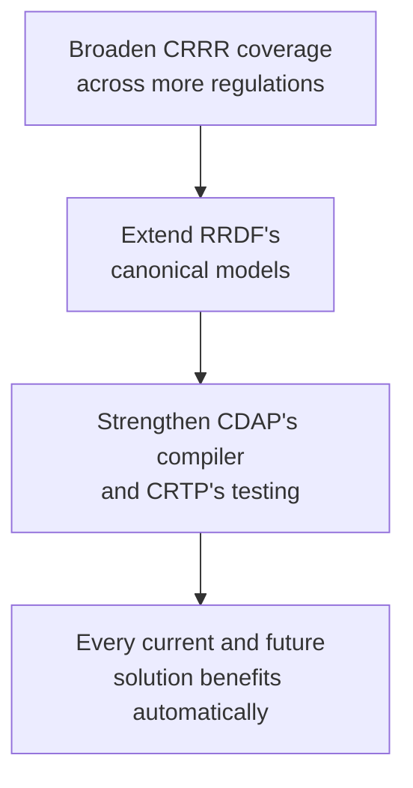
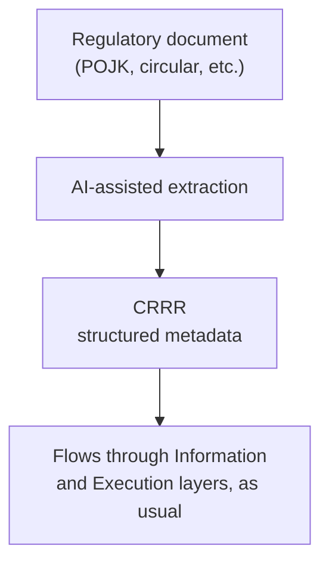
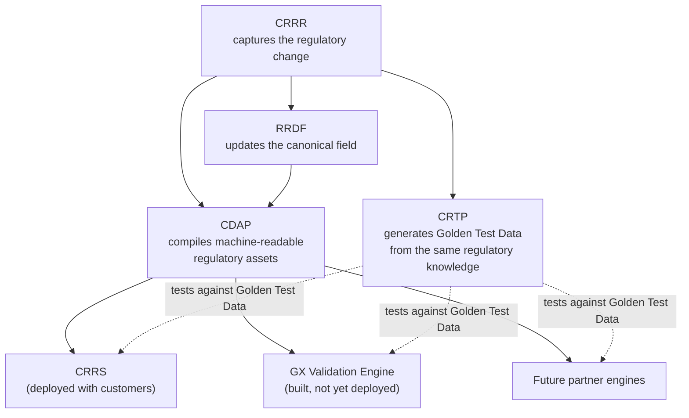
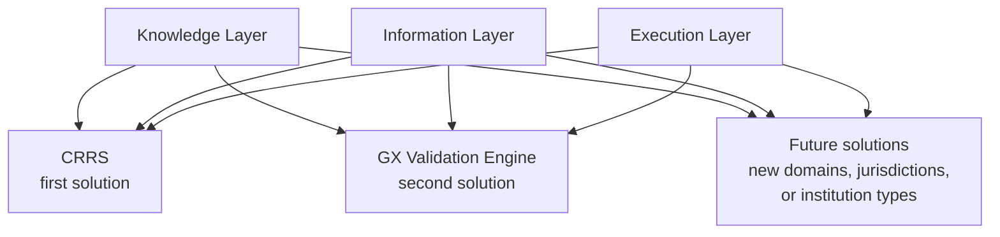

# Roadmap

> Where the platform is going, and why the order matters.

---

# How to Read This Roadmap

This roadmap covers the CygnetONE platform as a whole — the Knowledge, Information, and Execution layers, and the Solutions Layer that assembles them. It is not a roadmap for any single solution. CRRS, as the platform's first solution, has its own roadmap at [CRRS Roadmap](/products/crrs/roadmap); this page covers what CRRS and every future solution stands on.

This roadmap is organized by horizon, not by date. Regulatory technology moves on regulators' timelines as much as on engineering timelines, so committing to specific quarters would make this page stale faster than it stays useful.

What stays true regardless of timing is the *order*: each horizon builds on the layer beneath it, the same way the architecture itself does. Platform capability comes before solution expansion, and reach beyond the platform's own execution engine comes alongside it — because a new solution, or a new execution engine, is only as good as the knowledge, models, and execution services it can draw on.

---

# Near-Term: Deepening the Platform Every Solution Depends On

The near-term horizon is about strengthening the Knowledge, Information, and Execution layers themselves — not adding new solutions yet, and not specific to any one solution that currently runs on them.

- **Broader regulatory coverage in CRRR** — capturing more obligations, across more regulations, as structured metadata rather than one-off interpretations.
- **Richer canonical models in RRDF** — extending the regulatory Information Layer to keep pace with what CRRR captures, field by field, as regulations change. (CBDF, the platform's broader banking data foundation, evolves mostly independently of regulatory change, except where it shares structure with RRDF.)
- **A more capable CDAP, and more thorough CRTP** — deepening CDAP's ability to compile metadata into machine-readable regulatory assets, and CRTP's ability to test them, so new rules are exercised automatically rather than requiring bespoke code.

Because any solution is assembled from these layers rather than built independently, every one of these improvements reaches it without the solution itself needing to change. CRRS, as the platform's most mature solution today, is the first to benefit — but the work described here is platform work, not solution-specific work. See [Solutions Layer](/platform/solutions-layer) for why that's true architecturally.

---

# Mid-Term: Automating How Knowledge Gets Captured

The mid-term horizon is about changing *how* metadata enters CRRR in the first place — from expert-authored to AI-assisted.

Today, a subject matter expert reads a regulatory document and manually captures its obligations, definitions, and rules in CRRR. The mid-term goal is a pipeline that can take a regulatory document as published — a POJK, a circular, an implementing regulation — and produce a first structured draft of that metadata automatically, for a subject matter expert to review rather than author from scratch.

This doesn't change what CRRR produces, only how quickly and how consistently it gets produced. Everything downstream — RRDF, CDAP, CRTP, and every solution built on them, including CRRS today — consumes CRRR's metadata exactly the same way regardless of whether a human or an AI-assisted pipeline drafted it first. See [Solutions Layer](/platform/solutions-layer) for the fuller picture of why this automation is invisible to the solutions that depend on it.

---

# Mid-Term (Continued): Maturing and Extending Reach to Other Execution Engines

This isn't a hypothetical horizon. The platform has already produced a second execution engine from the same CRRR and RRDF foundation that drives CRRS: the **GX Validation Engine**, built on Great Expectations, compiled by CDAP from the same regulatory metadata that produces GoDQ inside CRRS. It's a partial engine — validation only, not the full reporting lifecycle CRRS covers — and it has been built but not yet deployed with a customer. The mid-term horizon is about maturing that engine toward deployment, and extending the same pattern to further execution engines beyond it.

RRDF is a consumer of CRRR change events too, not just a static schema CRRR happens to sit near. When a regulator changes what a field means or how it's formatted, that change should originate once in CRRR and propagate down into RRDF — not be patched separately into RRDF's canonical model by hand. CBDF, by contrast, is largely independent of regulatory change; it represents the platform's broader banking data foundation, and is only affected by CRRR indirectly, where it shares structure with RRDF.

A concrete example: Indonesia's shift from a 15-digit NPWP (taxpayer identification number) to a 16-digit NIK-based format, mandated by Ministry of Finance Regulation 112/PMK.03/2022 as amended by 136/PMK.03/2023, effective 1 July 2024. A change like this is captured once in CRRR — the field's new length, format, and effective date — and that single change is what updates RRDF's canonical `tax_id` field, rather than every canonical model and downstream report needing to be told separately that the format changed.

CDAP is the compiler that takes canonical regulatory intelligence — knowledge from CRRR, canonical models from RRDF — and produces machine-readable regulatory assets that an execution engine can consume. CRRS and GX Validation Engine are both consumers of exactly this compiled output today, proving CDAP's output isn't tied to one execution technology. The remaining mid-term goal is for CDAP to reach further execution engines the same way — including ones a bank already runs, licensed from other vendors — beyond the two it already serves.

CRTP depends on CRRR just as directly as CDAP does, but for a different purpose. To confirm that an execution engine has correctly implemented a regulatory change, CRTP needs to generate Golden Test Data that reflects what the regulation actually requires — not generic test cases, but data shaped by the same regulatory knowledge CRRR captured. Without that knowledge, CRTP has no way to know what a correct result should look like for a given regulation, and so no way to validate that an execution engine — CRRS, GX Validation Engine, or a future partner's — has implemented it correctly.

This depends on three things happening together:

- **Maturing GX Validation Engine toward deployment** — closing whatever gap remains between "built" and "deployed with a customer," and extending what CDAP compiles for it as needed.
- **Extending CRTP's Golden Test Data generation** — ensuring CRTP can generate regulation-accurate test data for each engine's data formats and conventions, so the same regulatory knowledge validates every engine correctly.
- **Signing up further execution engine partners** — banking-platform and systems-integration partners, including those with an exclusive local-market position on a particular core banking platform, who bring both a target execution engine and the domain expertise to integrate it well.

This is an extension of the same principle behind [Execution Technology Is Interchangeable](/platform/architecture): neither CDAP's output nor CRTP's Golden Test Data is tied to a single execution technology. CRRS and GX Validation Engine already prove it; extending that same relationship to further engines and partners is the remaining work.

---

# Long-Term: Further Solutions on the Same Foundation

The long-term horizon is where the platform's foundation gets reused again: further solutions beyond CRRS and GX Validation Engine, built on the same Knowledge, Information, and Execution layers rather than as independent codebases.

GX Validation Engine already proves the pattern holds for a second solution: built on the same CRRR and RRDF foundation as CRRS, without re-deriving regulatory knowledge or rebuilding canonical models. A future solution — for a different regulatory domain, a different jurisdiction, or a different type of financial institution — follows the same pattern. It does not need to rebuild regulatory knowledge, canonical models, or execution services; it starts from what the near- and mid-term work has already put in place, and builds only what is genuinely specific to it.

This is the same logic described in [Solutions Layer](/platform/solutions-layer): a portfolio of solutions, not a portfolio of silos.

---

# Why the Order Matters

It would be possible to build a third solution before deepening the platform, to promise AI-assisted extraction before the Knowledge Layer's metadata model is mature enough to receive it well, or to promise a wave of new partner execution engines before GX Validation Engine — the platform's own proof that CDAP and CRTP can serve an engine other than CRRS — has been matured to deployment. The roadmap is sequenced to avoid all three.

Strengthening the platform first means every later horizon inherits a stronger foundation instead of compounding shortcuts. This is the same principle described in [Platform Architecture](/platform/architecture) — knowledge before execution, execution before solutions — applied to how the platform grows over time, not just how it's structured today.

---

# Related Documentation

- [Platform Architecture](/platform/architecture) — the layered structure this roadmap builds on, including why execution technology is interchangeable.
- [Solutions Layer](/platform/solutions-layer) — why new solutions inherit platform capability instead of duplicating it.
- [Knowledge Layer](/platform/knowledge-layer) — the layer the mid-term AI-assisted extraction work targets.
- [CRRS Roadmap](/products/crrs/roadmap) — the roadmap for the platform's first solution specifically.
