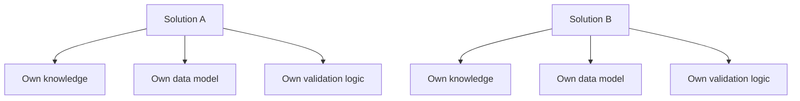
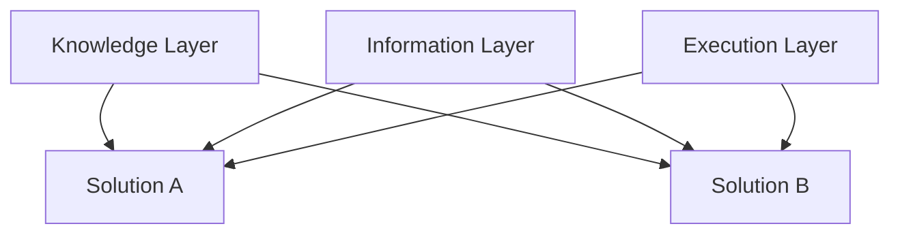
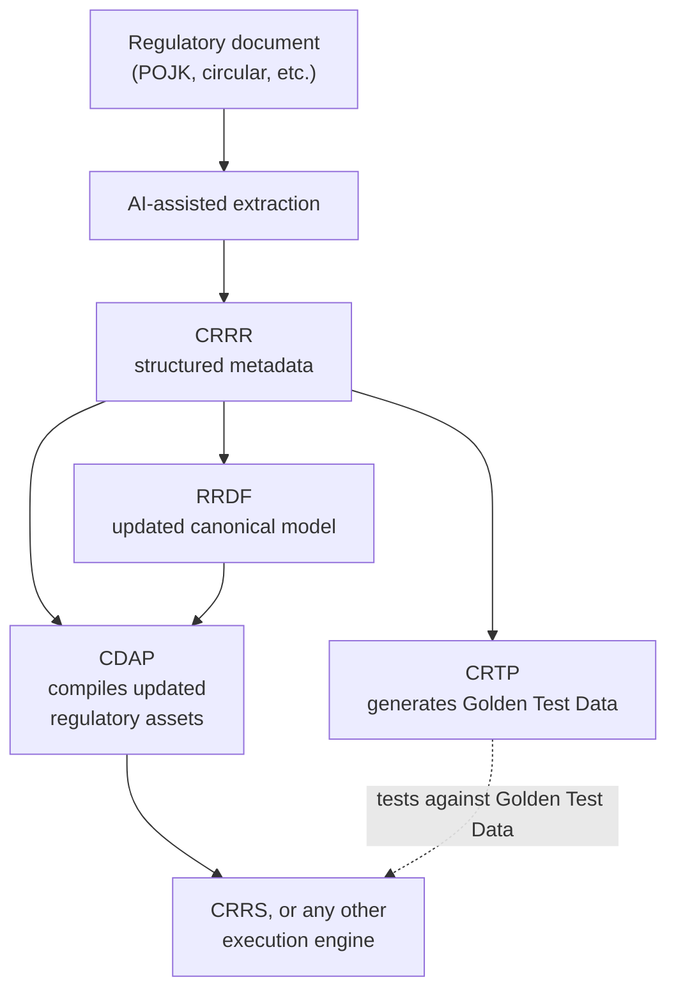

# Solutions Layer

> Where platform capability becomes something a customer actually deploys.

---

# Purpose

The Solutions Layer assembles the capabilities of the layers beneath it — Knowledge, Information, and Execution — into a complete business application.

It exists because knowledge, canonical models, and execution services are not, by themselves, something a bank can operate. A compliance team doesn't log into CRRR or CDAP directly; they log into a solution that was built on top of them.

The Solutions Layer is where the rest of the platform becomes usable.

---

# What Lives Here

The Solutions Layer represents:

- Deployable business applications — complete, like CRRS, or narrower in scope, like a validation-only engine
- User-facing workflows: submission, review, approval, monitoring
- Solution-specific configuration built on top of shared platform services
- The integration points that connect a solution to a bank's own operational systems

None of this duplicates what the layers below already provide. A solution's job is to assemble and present platform capability, not to re-implement validation logic, canonical models, or regulatory knowledge inside itself.

---

# Primary Products: CRRS and GX Validation Engine

CRRS — the Cygnet Regulatory Reporting Solution — is the platform's first solution, and the one currently deployed with customers.

CRRS takes the regulatory knowledge captured in CRRR, the canonical models defined by RRDF, and the execution logic CDAP compiles from them — tested by CRTP — and assembles them into an end-to-end reporting application: acquisition, validation, report generation, and workflow.

The platform has also produced a second execution engine from the same foundation: the **GX Validation Engine**, built on Great Expectations and compiled by CDAP from the same CRRR and RRDF metadata that drives GoDQ, CRRS's own validation component. GX Validation Engine is a partial engine — it covers validation, not the full reporting lifecycle CRRS provides — and has been built but not yet deployed with a customer. It exists today as concrete proof that CDAP's compiled output isn't tied to CRRS specifically: the same regulatory intelligence can produce a working validation engine on a different underlying technology.

See [CRRS Architecture](/products/crrs/architecture) for how CRRS itself is composed from these platform capabilities.

---

# Why Assembled, Not Built From Scratch

Traditional regulatory software builds each solution as an independent codebase. Every new solution re-implements its own validation rules, its own data models, and its own regulatory interpretations — even when it's solving a closely related problem.

The Solutions Layer inverts this. A solution is assembled from what the platform already provides, rather than rebuilt from first principles.

**Traditional approach** — each solution is its own silo:

**Solutions Layer approach** — every solution draws on the same shared foundation:

A new solution built this way inherits everything the platform has already captured, instead of starting from zero. This is not only a hypothetical: CRRS and the GX Validation Engine are both built this way today. GX Validation Engine's validation logic is compiled by CDAP from the same CRRR and RRDF metadata that produces GoDQ inside CRRS — it did not require re-deriving regulatory knowledge or rebuilding canonical models to exist.

---

# Governance

Solutions are held to the same discipline as every other layer, but the unit of governance shifts from individual metadata assets to the solution as a whole:

- **Versioned** — each solution release is tracked against the platform capabilities it was built on.
- **Owned** — each solution has a named product owner accountable for what it does with the platform beneath it.
- **Reviewed** — solution-specific configuration and workflow changes go through review, the same as changes to shared metadata.
- **Traceable** — because a solution assembles rather than duplicates platform capability, any behavior it exhibits can be traced back to the Knowledge, Information, or Execution layer that produced it.

This is what keeps a growing portfolio of solutions from drifting into a portfolio of independent, unrelated codebases.

---

# Relationship to Other Layers

The Solutions Layer is the only layer with no consumers above it — it depends on everything beneath it, and nothing depends on it.

- The **Knowledge Layer** supplies the regulatory knowledge a solution reports and validates against.
- The **Information Layer** supplies the canonical models a solution reads and writes.
- The **Execution Layer** compiles that knowledge and those models into the validation and processing logic a solution runs on, and tests that the result is correct.

See [Architecture](/platform/architecture) for how the full stack fits together.

---

# Why It Matters for AI

The Solutions Layer is not where AI-assisted regulatory interpretation happens — that work belongs further down the stack, in the Knowledge Layer. But it is the layer that ultimately benefits from it.

The long-term goal is to take a regulatory document as published by the regulator — a POJK, a circular, an implementing regulation — and feed it into a pipeline that produces structured, machine-readable metadata in CRRR automatically: obligations, field definitions, effective dates, validation rules. That change then reaches every layer above it the same way a manually authored change would, each for its own reason:

- **RRDF** updates its canonical model wherever the regulatory change affects a field it defines — a field's format, length, or meaning, for instance — without anyone hand-patching the canonical model separately.
- **CDAP** compiles the updated metadata into machine-readable regulatory assets.
- **CRTP** independently consumes the same CRRR metadata to generate the Golden Test Data needed to confirm an execution engine implements the change correctly — it cannot validate a rule it doesn't itself understand, so it depends on CRRR directly, not on CDAP's output.

Because a solution never re-implements knowledge or canonical models itself, and compilation happens entirely in CDAP, independent of any solution, a solution doesn't need to change at all for this automation to reach it. Whether CRRR's metadata was authored by a subject matter expert or extracted by an AI pipeline, CRRS, the GX Validation Engine, and any solution built after them simply consume what CDAP compiles, the same way, already tested by CRTP against regulation-accurate data. The automation is invisible to the solution; only the speed at which regulatory change reaches it improves.

---

# Why It Matters for Adding New Solutions

Because Solutions are assembled rather than built from scratch, adding a second solution to the platform did not mean duplicating CRRS's effort — and neither will the third, or the one after that.

GX Validation Engine is the proof: a second solution, built on the same Knowledge, Information, and Execution layers CRRS already uses, without re-deriving CRRR's regulatory knowledge or rebuilding RRDF's canonical models to get there. A future solution — for a different regulatory domain, a different jurisdiction, or a different institution type — follows the same pattern, and only needs to build what's genuinely specific to it.

This is also what makes the platform's roadmap possible: new solutions can be added as the business requires them, without each one re-deriving regulatory knowledge the platform already has. See [Roadmap](/platform/roadmap) for what's planned.

---

# Summary

The Solutions Layer is where "Knowledge Once. Execution Everywhere." becomes something a bank can actually log into.

CRRS and the GX Validation Engine are the first proof of this: two execution engines assembled from the same shared platform capability, rather than built as standalone systems. Every future solution follows the same pattern.
