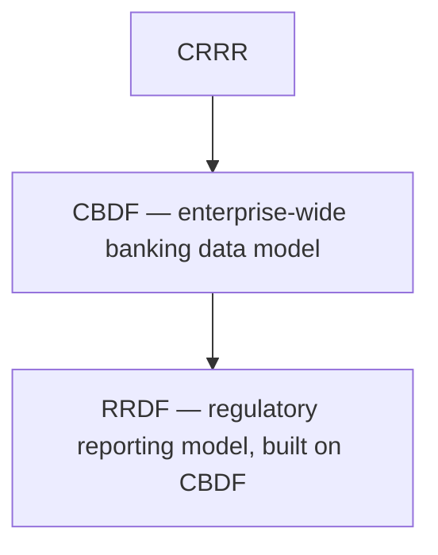

# Cygnet Banking Data Foundation (CBDF)

> A shared vocabulary for banking data, beyond regulatory reporting.

CBDF extends the canonical modeling approach established by RRDF beyond regulatory reporting to a broader model of core banking data.

Where RRDF defines the canonical entities regulatory reports are built from, CBDF provides the wider shared vocabulary that RRDF and other platform components build on — supporting enterprise-wide compliance capabilities that go beyond any single reporting obligation.

---

# Why CBDF Exists

Regulatory reporting is rarely the only place a bank needs a consistent definition of its own data. Risk management, internal controls, data governance, and policy management all depend on the same underlying concepts — customer, facility, exposure, transaction — that regulatory reporting does.

If each of these disciplines maintains its own definitions, the organization ends up with as many versions of "what is a customer" as it has functions asking the question.

CBDF addresses this by providing one canonical banking data model that RRDF, and other consumers beyond regulatory reporting, can build on.

---

# What CBDF Provides

- A canonical model of core banking entities, attributes, and relationships
- A shared vocabulary used consistently across regulatory reporting, risk, governance, and internal controls
- A foundation that RRDF and future platform components can extend for their specific domains
- Traceable definitions back to the business concepts and terminology captured in CRRR

---

# Relationship to RRDF

CBDF and RRDF share the same modeling philosophy — canonical, source-independent, traceable to CRRR — but operate at different scopes.

RRDF can be understood as a regulatory-reporting-focused specialization of the broader model CBDF establishes. Where a concept is common across the bank, CBDF defines it once; RRDF adds the reporting-specific structure needed for regulatory submissions.

---

# Beyond Regulatory Reporting

Because CBDF is not scoped narrowly to reporting, it is designed to support:

- Enterprise data governance
- Risk management
- Internal controls
- Data lineage
- Policy management
- Performance (Profitability) Management

This reflects the platform's broader vision: regulatory reporting is one application of a shared foundation, not the only one.

---

# Relationship to Other Products

- **Depends on:** CRRR, for the business concepts and terminology it models.
- **Supports:** RRDF, which builds its reporting-specific models on the foundation CBDF establishes.
- **Consumed by:** CDAP and CRTP, for execution services that operate against canonical data beyond regulatory reporting.

---

# Why It Matters

Without a shared banking data foundation, every function that touches customer, facility, or exposure data risks defining it differently — creating friction and inconsistency exactly where consistency matters most.

CBDF gives the organization one place to answer "what does this data mean," for regulatory reporting and for everything else that depends on the same underlying concepts.

---

# Related Documentation

- [Information Layer](/platform/information-layer) — the architectural role CBDF and RRDF share.
- [RRDF](/products/rrdf) — the regulatory-reporting-focused model built on CBDF.
