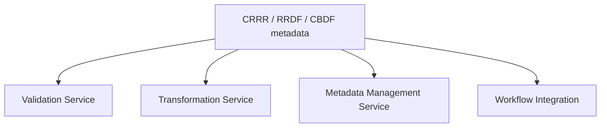
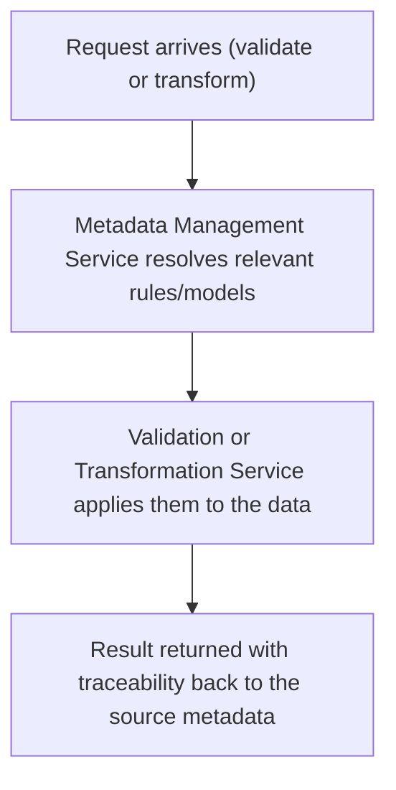
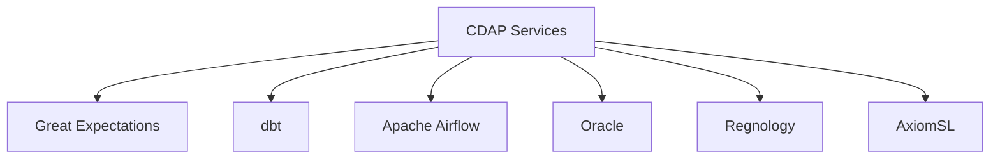

# CDAP Architecture

> How CDAP's execution services are structured.

---

# Service Areas

CDAP is organized around four service areas, each consuming metadata from the Knowledge and Information layers rather than embedding logic directly.

**Validation Service** — evaluates data against rules defined in CRRR, applied to data represented in RRDF/CBDF's canonical models.

**Transformation Service** — converts operational, source-system-shaped data into the canonical models defined by RRDF/CBDF.

**Metadata Management Service** — the runtime layer that resolves and serves metadata from CRRR, RRDF, and CBDF to the other services.

**Workflow Integration** — exposes CDAP's services so external orchestration tools (such as Apache Airflow) can sequence them as part of a larger process.

---

# Request Flow

A typical validation or transformation request flows through CDAP as follows:

Every result CDAP produces is traceable back to the specific piece of metadata that produced it — which rule failed validation, or which canonical field a value was mapped to — rather than being an opaque pass/fail.

---

# Pluggable Execution Technology

CDAP's service areas are implemented on top of interchangeable execution technology. The service interface stays stable even as the underlying engine changes — CDAP is execution-engine agnostic by design.

Today, only Great Expectations is actually wired up behind this interface — built independently, separate from CRRS's GoDQ validation service. The others illustrate what the pluggable architecture is designed to accommodate, not current capability.

This is what allows CygnetONE to adopt new execution technology over time without changing how solutions like CRRS interact with CDAP.

---

# Design Goals

- **Metadata-driven** — behavior is configured by CRRR/RRDF/CBDF metadata, not hard-coded per requirement.
- **Traceable** — every validation or transformation result links back to the metadata that produced it.
- **Technology-agnostic** — service interfaces are stable independent of the underlying execution engine.
- **Composable** — services can be called individually or orchestrated together via workflow integration.

---

# Related Documentation

- [CDAP](/products/cdap) — product overview.
- [Execution Layer](/platform/execution-layer) — the architectural role CDAP implements.
