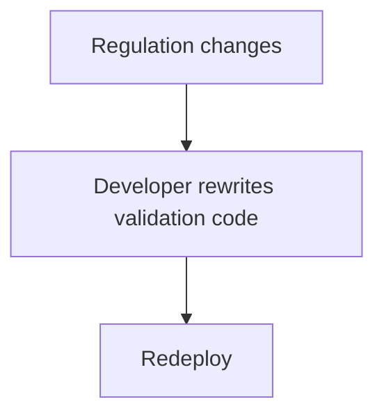
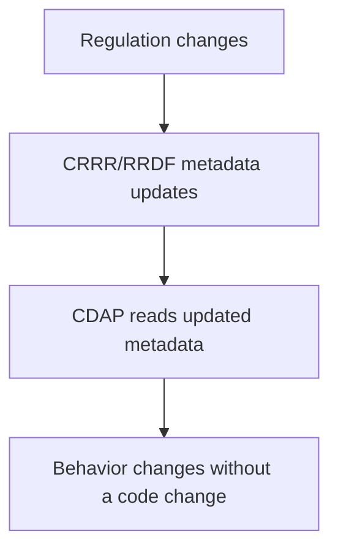
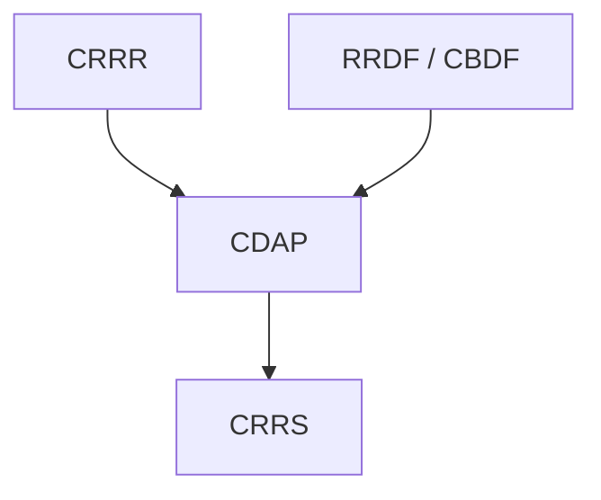

# Compliance Data Asset Platform (CDAP)

> Where regulatory knowledge is put to work.

CDAP is the platform component that implements the core of the CygnetONE Execution Layer.

It provides metadata-driven execution services — data validation, transformation, metadata management, and workflow integration — that consume the knowledge and canonical models defined in CRRR, RRDF, and CBDF to actually process data, rather than requiring every application to reimplement this logic separately.

---

# What CDAP Provides

- **Data validation** — metadata-driven, rule-based validation of data quality and regulatory compliance
- **Data transformation** — conversion of operational data into canonical information models, with full traceability
- **Metadata management** — the runtime services that read and apply metadata from CRRR, RRDF, and CBDF
- **Workflow integration** — hooks that let orchestration and automation tools drive CDAP's services as part of a larger process
- **Extensibility** — a foundation that compliance solutions, including CRRS, can build on rather than reimplement

---

# Metadata-Driven, Not Hard-Coded

The defining characteristic of CDAP is that its behavior is configured by metadata, not rewritten in code, when requirements change.

**Traditional execution:**

**CDAP:**

This is what allows solutions built on CDAP to keep pace with regulatory change without a full development cycle for every update.

---

# Execution Technology Is Interchangeable

CDAP is deliberately decoupled from any single execution technology. Its services may run on tools such as Great Expectations, dbt, Apache Airflow, Oracle, or Temenos today, and on different tools as the technology landscape evolves.

Because the knowledge and canonical models CDAP consumes live in the layers below it, the platform can adopt new execution technology without re-deriving the underlying regulatory logic.

See [CDAP Architecture](/products/cdap/architecture) for how these services are structured.

---

# Relationship to Other Products

- **Depends on:** CRRR (for rules and definitions) and RRDF/CBDF (for canonical models it operates against).
- **Works alongside:** CRTP, which verifies that CDAP's behavior remains correct as knowledge, models, or execution technology change.
- **Consumed by:** CRRS, whose data acquisition, validation, and transformation capabilities (GoETL, GoDQ) are built on CDAP.

---

# Why It Matters

Without a shared execution platform, every compliance solution would need to reimplement its own validation, transformation, and metadata-handling logic — duplicating effort and risking inconsistency between solutions.

CDAP gives every solution built on CygnetONE the same execution capabilities, configured by the same governed knowledge, so behavior stays consistent and regulatory change only has to be handled once.

---

# Related Documentation

- [CDAP Architecture](/products/cdap/architecture) — a deeper look at how CDAP's services are structured.
- [Execution Layer](/platform/execution-layer) — the architectural role CDAP implements.
- [CRTP](/products/crtp) — the regression testing platform that verifies CDAP's behavior over time.
- [CRRS](/products/crrs) — a solution built on top of CDAP.
