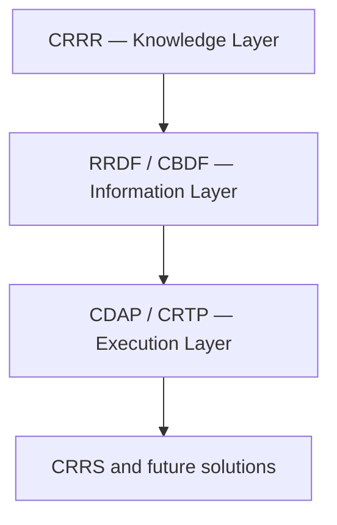

# Compliance Requirements & Regulatory Repository (CRRR)

> Where regulatory knowledge is captured once.

CRRR is the platform component that implements the CygnetONE Knowledge Layer.

It provides a structured repository for regulatory publications, business concepts, reporting requirements, validation rules, reference data, and regulatory metadata — captured once, by a subject matter expert, and made available to every other layer of the platform.

CRRR is not a document library. It is the authoritative, machine-readable source of regulatory knowledge that every other CygnetONE product ultimately depends on.

---

# The Problem CRRR Solves

In most financial institutions, regulatory knowledge is scattered: PDFs from regulators, spreadsheets maintained by individual analysts, business rules buried inside SQL and ETL code, and a great deal of tacit knowledge held by a small number of subject matter experts.

When a regulation changes, someone has to find every place that knowledge was used and update it independently. Nothing guarantees those updates are complete or consistent.

CRRR exists to make regulatory knowledge explicit, structured, and reusable — captured once, referenced everywhere, rather than copied and re-interpreted in every downstream system.

---

# What CRRR Captures

- Regulatory publications and their source references
- Reporting requirements, obligation by obligation
- Business terminology and definitions
- Validation and business rules
- Reference data and code sets
- Regulatory metadata — versioning, effective dates, jurisdiction, applicability

Each of these is stored as structured, version-controlled metadata rather than free-form documentation, so downstream systems can consume it directly instead of a human re-reading and re-interpreting it each time.

---

# How CRRR Is Used

CRRR sits at the foundation of the CygnetONE Platform's layered architecture.

Every layer above CRRR consumes the knowledge it governs. When a regulatory definition changes in CRRR, that change propagates upward — into canonical information models, into execution services, and ultimately into solutions like CRRS — without requiring parallel updates in every consuming system.

---

# Governance

Regulatory knowledge in CRRR is treated as a versioned, owned, reviewable asset:

- **Versioned** — every change is tracked, with effective and expiry dates.
- **Owned** — each knowledge asset has a named owner responsible for its accuracy.
- **Reviewable** — changes go through review before they propagate to consuming systems.
- **Traceable** — every downstream artifact can be traced back to the regulatory source it implements.

This governance discipline is what allows the rest of the platform to trust CRRR's contents without independently re-verifying them.

---

# Relationship to Other Products

CRRR is the only platform component with no upstream dependency — every other product depends on it, directly or indirectly.

- **RRDF** and **CBDF** transform CRRR's regulatory concepts into canonical information models.
- **CDAP** and **CRTP** consume CRRR's rules and definitions to drive validation, transformation, and testing.
- **CRRS** inherits regulatory knowledge indirectly, through the Information and Execution layers.

---

# Why It Matters

Structured regulatory knowledge is also the foundation for reliable AI-assisted compliance work. Large language models are effective at interpreting structured information, but inconsistent without it. A well-governed CRRR gives AI applications — regulation interpretation, impact analysis, knowledge search — a trustworthy foundation to reason over, instead of raw, unstructured documents.

CRRR is where the platform's core belief becomes concrete: regulatory knowledge is an enterprise asset, not application logic.

---

# Related Documentation

- [Platform Architecture](/platform/architecture) — how CRRR fits into the full layered architecture.
- [Knowledge Layer](/platform/knowledge-layer) — the architectural role CRRR implements.
- [CRRS](/products/crrs) — a solution built on top of CRRR.
