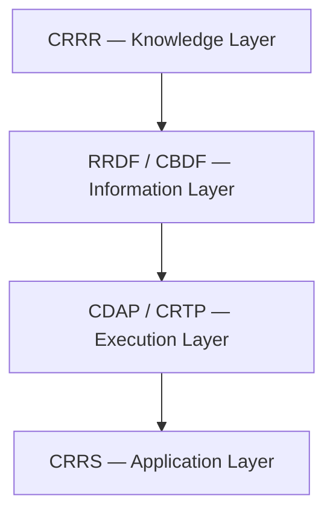
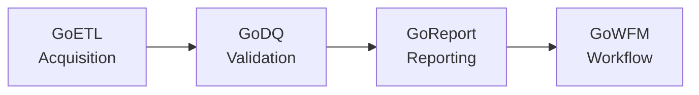
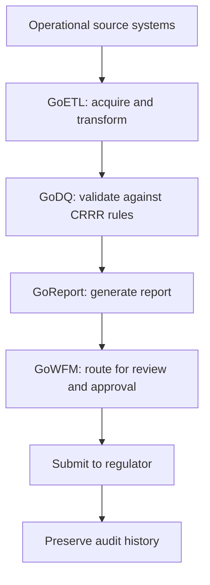

# CRRS Architecture

> How CRRS is assembled from the CygnetONE Platform.

---

# CRRS Is Not a Standalone Application

CRRS is a solution — it is assembled from reusable platform capabilities rather than built as an independent codebase.

This means CRRS inherits regulatory knowledge, canonical models, and execution services from the platform, rather than re-implementing them. When a regulation changes, that change flows up through the stack into CRRS automatically.

---

# CRRS Components

CRRS is composed of four core components, each responsible for one stage of the reporting lifecycle.

**GoETL** — consolidates data staged in the bank's interface layer into CRRS's canonical reporting data store. Upstream extraction from a bank's core operational systems into that interface layer is typically handled by a separate ETL process outside CRRS; GoETL takes over from there, transforming interface data into RRDF/CBDF's canonical structures.

**GoDQ** — performs metadata-driven data quality assessment and regulatory validation against rules defined in CRRR, and provides explainable validation results.

**GoReport** — generates regulatory reports from validated data and regulatory metadata, supports report review and submission, and includes the scheduler that determines when each processing job (data ingestion, validation, report generation, output creation, and other scheduled system jobs such as LDAP synchronization) is run.

**GoWFM** — coordinates workflow execution, approvals, monitoring, and operational management across the reporting lifecycle.

Each component is built on CDAP's execution services rather than implementing validation, transformation, or workflow logic independently.

---

# End-to-End Data Flow

Every stage of this flow operates against the canonical models defined by RRDF/CBDF and the rules defined by CRRR — so the same underlying regulatory knowledge that governs validation also governs what gets reported and how it is explained.

---

# Why This Architecture Matters

Because CRRS is assembled from platform capabilities rather than built as a standalone application, it benefits directly from platform-level improvements: a new regulatory interpretation captured in CRRR, a refined canonical model in RRDF, or a new execution capability added to CDAP all become available to CRRS without requiring CRRS-specific rework.

This is the same principle described in [Platform Architecture](/platform/architecture), applied to a concrete solution.

---

# Related Documentation

- [CRRS](/products/crrs) — product overview.
- [CRRS Capabilities](/products/crrs/capabilities) — what each component enables in practice.
- [Platform Architecture](/platform/architecture) — the layered architecture CRRS is built on.
