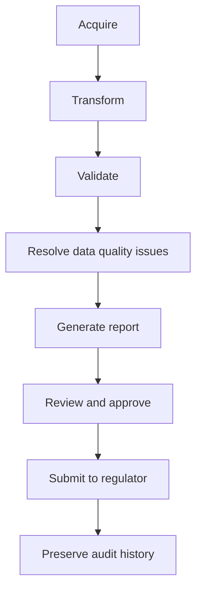

# CRRS Capabilities

> What CRRS enables across the regulatory reporting lifecycle.

---

# Data Acquisition

CRRS consolidates data staged in the bank's interface layer and transforms it into standardized reporting structures, powered by GoETL and built on CDAP's transformation services. Extraction from the bank's core operational systems into that interface layer is typically handled by a separate upstream ETL process outside CRRS; GoETL takes over from the interface layer onward.

Because this transformation targets RRDF/CBDF's canonical models rather than a single source system's schema, adding a new source system does not require redesigning downstream validation or reporting logic.

---

# Data Validation

CRRS validates data quality and regulatory compliance using metadata-driven validation rules, powered by GoDQ.

Validation rules come directly from CRRR — when a regulatory requirement changes, the validation behavior updates without a code change. Results are explainable: a failed validation traces back to the specific rule and regulatory source that produced it, not just a generic error.

---

# Scalability

CRRS is designed to serve banks across a wide range of sizes — from a small bank with a handful of branches and accounts, to very large banks with hundreds of branches and tens of millions of accounts.

The key enabler is incremental validation. Most of the data a bank reports on is stable from one reporting cycle to the next: the overwhelming majority of customers don't change residency status month to month, the overwhelming majority of savings accounts — usually the largest single data volume a bank holds — aren't opened or closed in any given cycle. Only a small fraction of records actually change.

CRRS applies a simple governing principle: **revalidation should only happen when there is certainty the outcome will differ. Otherwise, don't revalidate.**

Some applications, more common among smaller banks with smaller data volumes, revalidate the entire dataset every time they run. At the scale of tens of millions of accounts, that approach doesn't hold up. CRRS instead validates incrementally at two levels:

- **Cycle-over-cycle delta** — when a new reporting cycle runs, CRRS validates only the records that changed since the last cycle (new accounts, closed accounts, status changes), not the full dataset. Seventy million savings account records don't get revalidated in full each month — only the delta does.
- **Row-level, post-edit** — once a dataset has been validated and a user subsequently edits specific rows, only the edited rows are revalidated. Unedited rows are not touched again.

This is what allows CRRS's validation performance to scale with the *rate of change* in a bank's data, rather than the *total volume* of that data.

Scalability is also addressed on the acquisition side. Where a regulator permits it, CRRS's data ingestion can aggregate source records along regulator-mandated dimensions before processing, rather than carrying every individual record through the full pipeline. For example, a bank with 70 million savings accounts may find that 32 million of them carry a zero balance — where the regulator allows aggregation of such accounts along dimensions like currency and product type, CRRS aggregates them at ingestion, reducing the volume that needs to flow through validation, transformation, and reporting to roughly 38 million records. This is illustrative of the kind of reduction the approach can achieve, not a fixed benchmark — the actual reduction depends on the obligation's rules and a bank's specific account mix.

---

# Data Transformation

CRRS converts operational data into regulatory reporting models while maintaining complete traceability from source field to reported value.

Because transformation targets the same canonical models used throughout the platform, the same transformed data can support reporting, analytics, and future execution engines without being re-derived separately for each.

---

# Regulatory Reporting

CRRS generates regulatory reports in the formats required by regulators, powered by GoReport.

Report generation draws on the same validated, canonical data produced earlier in the pipeline — reports are not a separate re-interpretation of the underlying data, but a direct output of it.

---

# Workflow Management

CRRS coordinates review, approval, and submission activities, and operational monitoring, powered by GoWFM — working alongside GoReport's own scheduler, which drives execution timing for validation and report generation.

This gives compliance teams visibility into where a report is in its lifecycle — acquired, validated, generated, under review, or submitted — and control over who can move it between those stages.

---

# Audit and Governance

CRRS provides explainable reporting with complete lineage from regulatory requirement to reported value.

Every reported figure can be traced back through transformation and validation to the source data and the regulatory rule that shaped it — supporting audit and governance expectations without separate, manually-maintained documentation.

---

# Typical Reporting Lifecycle

1. Acquire operational data.
2. Transform data into canonical information models.
3. Validate business and regulatory rules.
4. Resolve data quality issues.
5. Generate regulatory reports.
6. Review and approve submissions.
7. Submit reports to regulators.
8. Preserve complete audit history.

---

# Related Documentation

- [CRRS](/products/crrs) — product overview.
- [CRRS Architecture](/products/crrs/architecture) — how these capabilities are structured internally.
