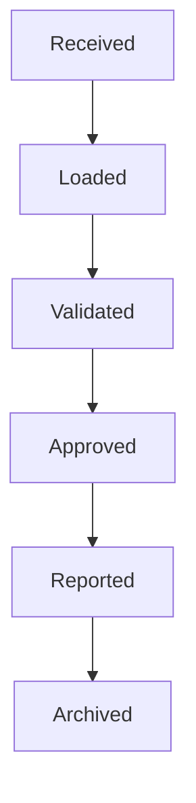

# Data Control

> Tracking the status of every dataset moving through the reporting lifecycle.

---

# Purpose

Every dataset loaded into CRRS is tracked through a control record capturing its identity, reporting period, current processing status, timestamps, validation status, and workflow status. This gives operators a single place to answer "where is this dataset right now?" without inspecting individual pipeline stages directly.

---

# Lifecycle

Each dataset's control record advances through this lifecycle as it moves through GoETL, GoDQ, GoReport, and GoWFM.

---

# Status Tracking

Typical processing states include pending, running, completed, validation error, failed, and cancelled.

---

# Benefits

Data control provides restart capability — a failed dataset can resume rather than reload from scratch — a basis for the audit trail, operational monitoring and dashboards, and integration with [Workflow](/products/crrs/concepts/workflow), so a dataset's technical processing status and its business review status are both visible from the same record.

---

# Operational Visibility

Administrators can immediately see which datasets succeeded, which failed, and which need attention — important given the fixed, often tight deadlines described in [Reporting Cycle](/products/crrs/concepts/reporting-cycle).

---

# Relationship to Other Concepts

- [Workflow](/products/crrs/concepts/workflow) — data control tracks technical processing status; workflow tracks business review and approval status. Together they give a complete picture of where a dataset stands.
- [Delta Processing](/products/crrs/concepts/delta-processing) — the control record reflects which delta a dataset represents within its cycle.
- [Data Lineage](/products/crrs/concepts/lineage) — control records contribute to the operational history that lineage and the audit trail draw on.

---

# Why It Matters

At the scale and deadline pressure CRRS operates under, not knowing whether a dataset succeeded, failed, or is still running is itself an operational risk. Data control makes that status explicit and queryable rather than something that has to be inferred from logs.
