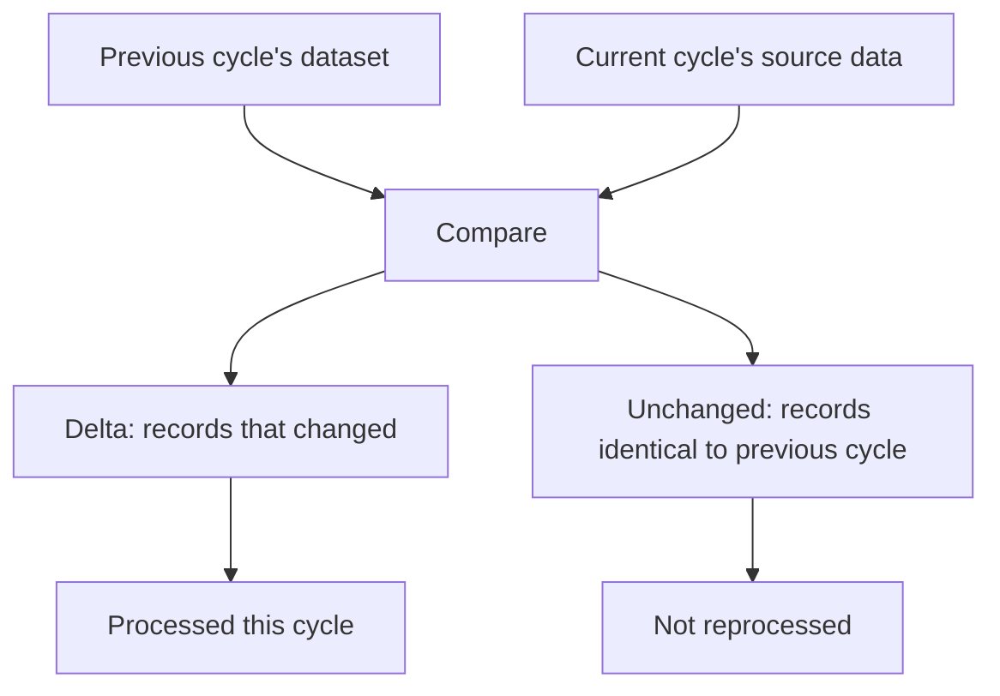
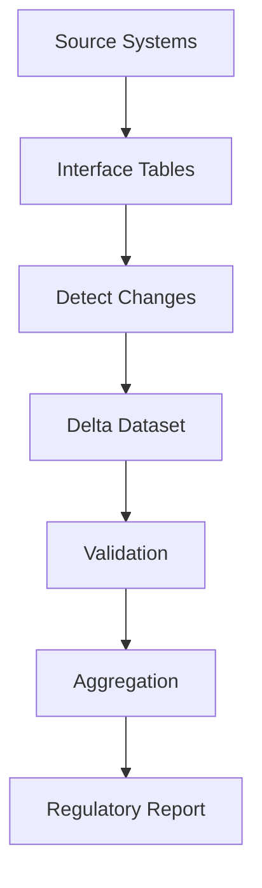

# Delta Processing

> Process what changed, not everything that exists.

---

# The Concept

Delta processing is the practice of identifying the subset of data that changed since a reference point — typically the previous reporting cycle — and limiting downstream processing to that subset, instead of reprocessing an entire dataset every time.

It is the foundational concept behind CRRS's ability to scale from a small bank with a handful of branches to a large bank with tens of millions of accounts: processing cost scales with the *rate of change* in the data, not its total volume.

---

# Why It Works

Most of the data a bank reports on is stable from one reporting cycle to the next.

- The overwhelming majority of customers do not change residency status in any given month.
- Savings accounts — usually a bank's largest single data volume — are not opened or closed en masse; only a small fraction change in a given cycle.
- Most facilities, exposures, and reference data remain unchanged cycle over cycle.

Reprocessing tens of millions of unchanged records to re-derive the same result every cycle is wasted work. Delta processing identifies the (typically small) set of records that actually changed, and processes only those.

**Illustrative example (not a benchmark):** a large bank's dataset might include on the order of tens of millions of account records, millions of loan records, and a much larger volume of underlying transactions. On any given day, only a small fraction of that population typically changes — often a low single-digit percentage or less. The exact proportion varies by bank and by data domain; the figures here are for illustration only, not a claimed measurement.

---

# What Counts as a Delta

A record is part of the delta when its relevant attributes differ from the previous cycle. Typical examples in a banking context include:

- A new account opened, or an existing account closed.
- A customer's residency status changing.
- A change to an account's balance, status, or classification that affects a reporting obligation.
- A correction made to previously acquired data.

Records with no relevant change — the majority, at scale — fall outside the delta and are not reprocessed.

---

# Types of Changes Detected

More generally, CRRS's delta detection recognizes four categories of change:

- **New records** — data that didn't exist in the previous cycle.
- **Updated records** — existing data whose values changed.
- **Deleted records** — data present previously that no longer applies.
- **Corrected historical records** — retroactive corrections to data from a prior period.

---

# The Delta Pipeline

Delta processing sits at the front of the pipeline, before validation and downstream processing occur.

---

# Where Delta Processing Applies

Delta processing is not limited to validation. It is a general pattern applied wherever CRRS would otherwise repeat work unnecessarily:

- **Acquisition (GoETL)** — identifying which source records have changed since the last acquisition run.
- **Validation (GoDQ)** — determining which records need to be re-evaluated against business and regulatory rules. See [Incremental Validation](/products/crrs/concepts/incremental-validation) for how this is applied specifically to validation.
- **Reporting** — recognizing which reported values are affected by a change, rather than regenerating a report from scratch.

---

# Relationship to Other Concepts

- [Incremental Validation](/products/crrs/concepts/incremental-validation) — the validation-specific application of delta processing, governed by the principle that revalidation should only happen when the outcome could differ.
- [Reporting Cycle](/products/crrs/concepts/reporting-cycle) — the cadence delta processing operates against.

---

# Benefits

- **Faster reporting** — processing time tracks the size of the delta, not the full dataset.
- **Lower infrastructure cost** — less compute and I/O spent re-deriving already-known results.
- **Shorter reporting windows** — critical when deadlines are fixed calendar dates (see [Reporting Cycle](/products/crrs/concepts/reporting-cycle)).
- **Easier reprocessing** — reprocessing a correction touches only the affected delta, not the full dataset.

---

# Why It Matters

Without delta processing, every reporting cycle would cost roughly the same regardless of how much actually changed — an approach that works for a small bank's dataset but becomes impractical at tens of millions of records.

Delta processing keeps CRRS's processing cost proportional to what actually changed, which is what makes the same solution viable for both a small bank and a very large one.
