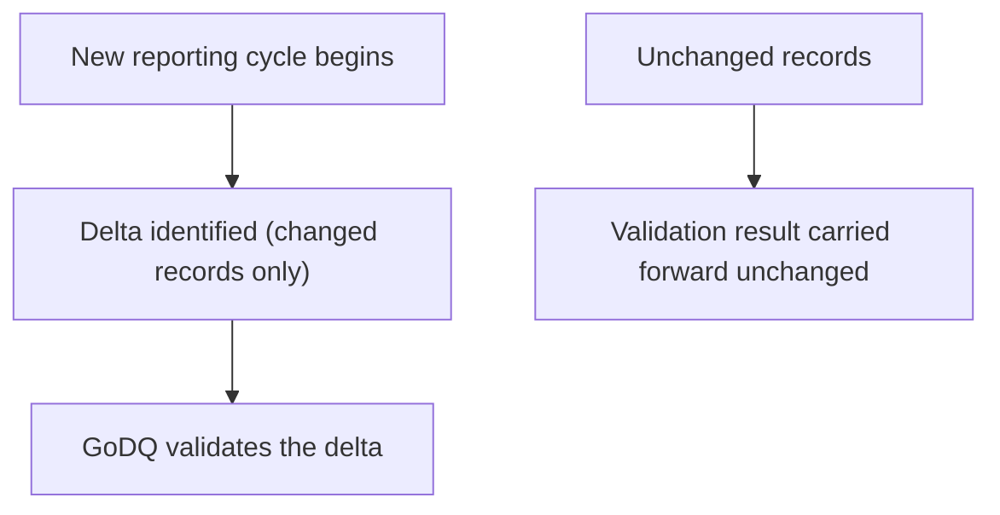
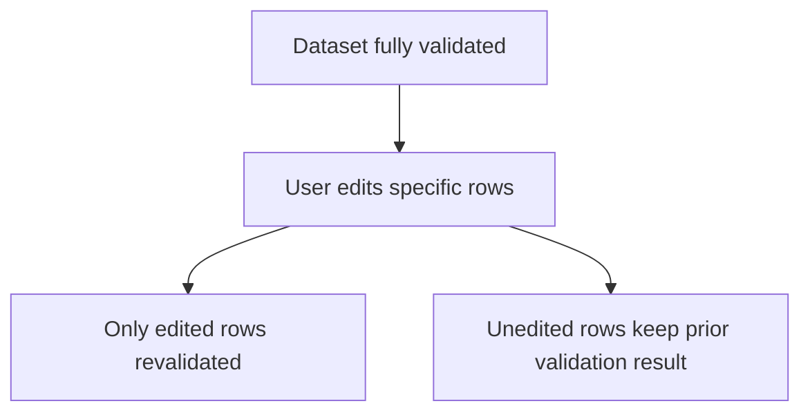
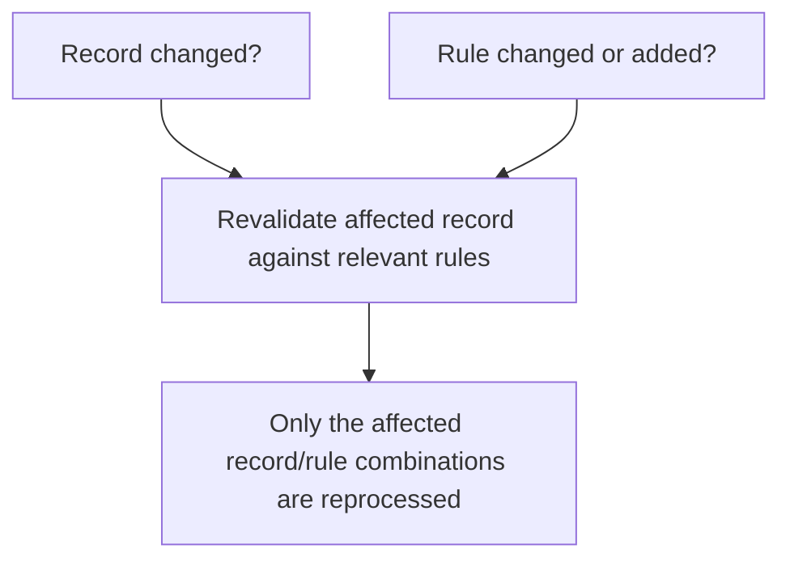

# Incremental Validation

> Revalidate only when the outcome could actually change.

---

# The Governing Principle

CRRS applies a single governing principle to validation: **revalidation should only happen when there is certainty the outcome will differ. Otherwise, don't revalidate.**

This sounds obvious, but many applications — particularly those built for smaller banks with smaller data volumes — don't follow it. They revalidate the entire dataset on every run, because at a small enough scale the cost of doing so is tolerable. At the scale of tens of millions of accounts, that approach stops being tolerable.

CRRS is built on the assumption that most data doesn't need to be looked at again, and applies incremental validation at two distinct levels.

---

# Level 1: Cycle-Over-Cycle Delta Validation

At the start of a new reporting cycle, CRRS does not revalidate the full dataset. It validates the delta — the set of records identified by [Delta Processing](/products/crrs/concepts/delta-processing) as having changed since the previous cycle — and leaves unchanged records as-is.

For a bank with seventy million savings account records, this means seventy million records are not revalidated each month. Only the (typically much smaller) set that actually changed — new accounts, closed accounts, status changes — goes through validation again.

---

# Level 2: Row-Level Revalidation After Edits

Once a dataset has completed initial validation, a user may edit specific rows — correcting a value flagged by validation, for example. CRRS does not revalidate the entire dataset in response to an edit.

Only the edited rows are revalidated. Rows that were not touched retain their existing validation result.

This matters operationally as much as it matters for performance: a compliance analyst correcting ten rows out of a million-row dataset should not have to wait for the other 999,990 rows to be re-checked before seeing whether their correction resolved the issue.

---

# Double-Sided Incremental Validation

Level 1 and Level 2 both ask "did this record change?" But a record's validation outcome can also change for a different reason: the validation rule that applies to it changed, even if the record itself did not.

CRRS's incremental validation is double-sided — it considers both dimensions together:

- **Which records changed** — the record side, covered by Levels 1 and 2 above.
- **Which validation rules changed or were newly added** — the rule side, sourced from CRRR (see [Knowledge Layer](/platform/knowledge-layer)).

Only the specific record/rule combinations affected by a change on either side are revalidated. A record that hasn't changed still gets revalidated against a rule that has changed and now applies to it; conversely, a record that changed is only revalidated against the rules that could plausibly be affected by that specific change, not the full rule set.

---

# Why "Certainty the Outcome Will Differ" Is the Right Bar

The principle is deliberately conservative in one direction and aggressive in the other: CRRS will always revalidate a record when there's a change that could plausibly affect the result, but it will never skip validation on a record where the outcome is genuinely uncertain. The optimization only applies to the case where nothing has changed that the validation rules depend on — in which case, by construction, re-running the same rule against the same data would produce the same result.

This is what distinguishes incremental validation from simply skipping work: it is not a shortcut that risks missing a data quality issue, it is the recognition that re-deriving an already-known answer provides no additional information.

---

# Further Advantages

Beyond the direct reduction in validation workload, restricting revalidation to affected record/rule combinations also:

- **Supports multiple validation engines** — because the scope of what needs revalidating is well-defined, different validation engines (see [CDAP Architecture](/products/cdap/architecture) for pluggable execution technology) can be applied to a narrower, more manageable workload.
- **Is well-suited to parallel execution** — a smaller, well-defined set of affected record/rule combinations partitions more naturally across parallel workers than a full-dataset revalidation would.

---

# Relationship to Other Concepts

- [Delta Processing](/products/crrs/concepts/delta-processing) — the general pattern that identifies which records changed; incremental validation is its application to GoDQ specifically.
- [Reporting Cycle](/products/crrs/concepts/reporting-cycle) — the cadence that Level 1 (cycle-over-cycle) incremental validation operates against.
- [Partitioning](/products/crrs/concepts/partitioning) — how the affected record/rule workload is organized for parallel execution.

---

# Why It Matters

Incremental validation is the concept that makes CRRS's validation performance scale with the rate of change in a bank's data rather than its total volume — which is what allows the same solution to serve both a small bank and a bank with tens of millions of accounts, without the cost of validation growing unmanageably as data volume grows.
