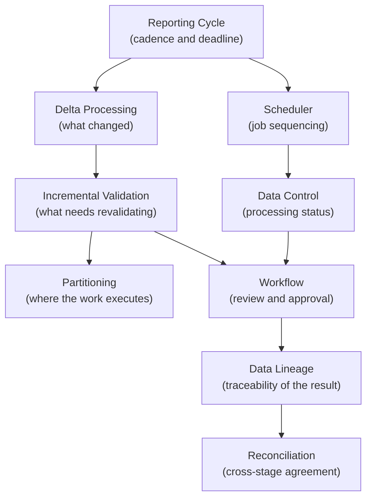

# CRRS Concepts

> The ideas that let CRRS handle large-scale regulatory reporting within tight, fixed deadlines.

CRRS is built for regulatory reporting environments where large volumes of data must be processed within limited, often fixed, reporting windows (see [Reporting Cycle](/products/crrs/concepts/reporting-cycle)).

Rather than reprocessing everything on every run, CRRS is built around a small set of concepts that together keep processing cost proportional to what actually changed, not to the total size of a bank's data.

---

# Core Concepts

| Concept | What It Covers |
|---|---|
| [Reporting Cycle](/products/crrs/concepts/reporting-cycle) | The cadence and deadline structure for a regulatory obligation, and the iterations within a cycle from initial load through submission. |
| [Delta Processing](/products/crrs/concepts/delta-processing) | Identifying and processing only the records that changed since the previous cycle. |
| [Incremental Validation](/products/crrs/concepts/incremental-validation) | Revalidating only the record/rule combinations affected by a change — on the record side and the rule side. |
| [Partitioning](/products/crrs/concepts/partitioning) | Organizing large datasets so processing and parallel execution touch only the relevant subset. |
| [Data Lineage](/products/crrs/concepts/lineage) | Tracing every reported value back through transformation and validation to its source. |
| [Workflow](/products/crrs/concepts/workflow) | Coordinating review, correction, and approval of a report before submission. |
| [Scheduler](/products/crrs/concepts/scheduler) | Deciding what processing jobs run, when, in what order, and how failures are retried. |
| [Data Control](/products/crrs/concepts/data-control) | Tracking the technical processing status of every dataset through the reporting lifecycle. |
| [Reconciliation](/products/crrs/concepts/reconciliation) | Confirming reported values agree with underlying data across each processing stage. |

---

# How These Concepts Fit Together

Each concept addresses a different part of the same underlying problem: producing correct, explainable regulatory reports within a deadline that doesn't move, at a data volume where reprocessing everything every time isn't practical.

---

# Related Documentation

- [CRRS](/products/crrs) — product overview.
- [CRRS Architecture](/products/crrs/architecture) — how GoETL, GoDQ, GoReport, and GoWFM implement these concepts.
- [CRRS Capabilities](/products/crrs/capabilities) — the capabilities these concepts support, including [Scalability](/products/crrs/capabilities#scalability).
