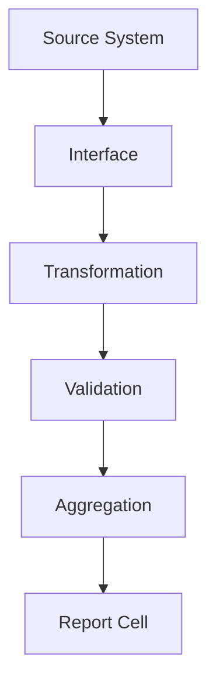
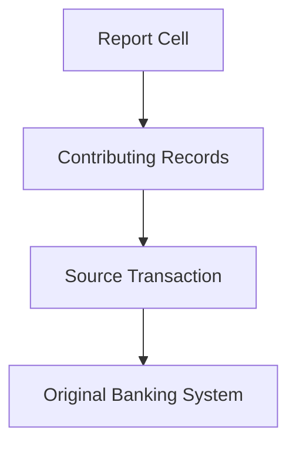

# Data Lineage

> Every reported figure must be explainable.

---

# Why Lineage Matters

Regulators routinely ask a simple but demanding question about any reported figure: *where did this number come from?* Answering that question after the fact — reconstructing how a value was derived, weeks or months later — is expensive and error-prone if lineage wasn't captured as the data moved through the system.

CRRS maintains lineage continuously, as data flows through the platform, rather than trying to reconstruct it retroactively.

---

# What Lineage Tracks

CRRS maintains lineage across every stage a piece of data passes through:

Every value that ends up in a submitted report can be traced back through this chain to the specific source record it originated from, and every transformation and validation step it passed through along the way.

---

# Drilling Down From a Report Cell

Lineage is navigable in both directions, but the direction that matters most in practice is backward: starting from a reported figure and working back to its source.

This lets a compliance analyst answer "where did this number come from?" by navigating directly from the reported cell down to the original transaction in the source banking system, rather than manually reverse-engineering the calculation.

---

# Relationship to Other Concepts

- [Delta Processing](/products/crrs/concepts/delta-processing) — lineage is what makes it possible to say precisely which reported values are affected by a given delta, rather than only which source records changed.
- [Workflow](/products/crrs/concepts/workflow) — lineage and workflow history together form the full audit trail for a submitted report.

---

# Why It Matters

- **Audit support** — auditors and regulators can be shown exactly how a figure was derived, not just told.
- **Faster investigations** — tracing an unexpected value back to its source is a lookup, not a reconstruction project.
- **Regulatory confidence** — explainability is demonstrated directly, rather than asserted.
- **Business transparency** — the same drill-down capability that supports audits also helps internal teams understand their own reported numbers.
