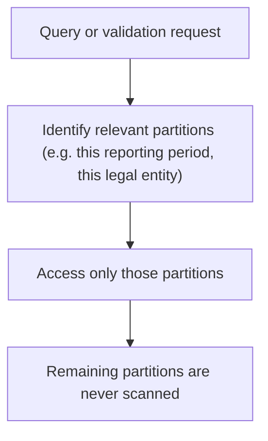

# Partitioning

> Organizing large datasets so only the relevant subset ever needs to be touched.

---

# The Concept

Partitioning organizes large datasets into smaller, well-defined subsets so that queries, validation, and parallel execution can operate on only the relevant subset rather than scanning an entire dataset.

Where [Delta Processing](/products/crrs/concepts/delta-processing) and [Incremental Validation](/products/crrs/concepts/incremental-validation) reduce *how much* data needs processing, partitioning is about organizing that data so the reduced workload can actually be accessed and executed efficiently.

---

# Typical Partition Keys

CRRS commonly partitions data along dimensions that reflect how a bank's reporting obligations are actually structured, including:

- **Business date** — the date the data relates to.
- **Reporting period** — the cycle a given obligation's data belongs to (see [Reporting Cycle](/products/crrs/concepts/reporting-cycle)).
- **Branch** — where relevant to how the bank organizes its operations.
- **Legal entity** — for banking groups reporting across more than one legal entity.

Depending on the underlying database's capabilities, these keys may be combined — for example, partitioning by reporting period and legal entity together.

---

# Partition Pruning

Partition pruning allows a query or process to access only the partitions relevant to it, rather than scanning the full dataset.

Combined with delta processing, this means CRRS's processing is narrowed twice over: first to the records that changed, then to the partitions those records actually live in.

---

# Parallel Processing

Because partitions are well-defined and largely independent of one another, different partitions can be processed simultaneously.

This is what allows CRRS's execution layer (CDAP) to scale out validation, transformation, and reporting work across multiple parallel workers, rather than being limited to a single sequential pass over the data.

---

# Relationship to Other Concepts

- [Delta Processing](/products/crrs/concepts/delta-processing) — reduces which records need attention; partitioning organizes how those records (and the full dataset) are physically accessed.
- [Incremental Validation](/products/crrs/concepts/incremental-validation) — the affected record/rule combinations identified by incremental validation are executed against the relevant partitions, not the whole dataset.
- [Reporting Cycle](/products/crrs/concepts/reporting-cycle) — reporting period is itself a common partition key.

---

# Why It Matters

Without partitioning, even a well-scoped delta still has to be located within an undifferentiated mass of data. Partitioning gives CRRS a structural way to isolate exactly the data a given process needs — and to spread that work across parallel execution — instead of relying on scanning large tables to find what matters.
