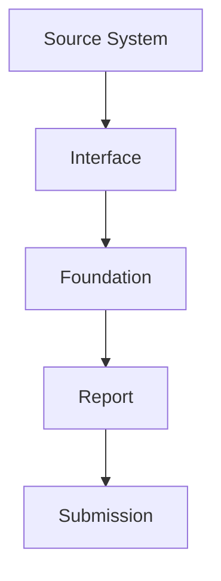

# Reconciliation

> Confirming that what gets reported agrees with the underlying business data at every stage.

---

# Purpose

Reconciliation checks that values agree with each other as data moves through CRRS's processing stages, rather than trusting that a transformation or aggregation step produced a correct result.

---

# Typical Reconciliation Points

CRRS reconciles values between adjacent stages in this chain — source vs. interface, interface vs. foundation, foundation vs. report, and report vs. submission — so a discrepancy is caught close to where it was introduced.

---

# Balance Checks

Typical checks include structural accounting identities (e.g. assets equal liabilities plus equity) and control totals such as loan totals, deposit totals, and customer counts, compared before and after a processing stage.

---

# Exception Management

A discrepancy is recorded as a reconciliation exception rather than silently resolved. Exceptions can be reviewed, investigated, resolved, and approved — following the same review discipline described in [Workflow](/products/crrs/concepts/workflow).

---

# Relationship to Other Concepts

- [Data Lineage](/products/crrs/concepts/lineage) — when a reconciliation exception is raised, lineage is what lets an analyst trace the discrepancy back to its source.
- [Workflow](/products/crrs/concepts/workflow) — reconciliation exceptions go through the same review and approval discipline as other corrections.
- [Incremental Validation](/products/crrs/concepts/incremental-validation) — validation checks a record against regulatory rules; reconciliation checks that aggregate values agree with each other across processing stages — a complementary, not overlapping, form of quality check.

---

# Why It Matters

Regulators and auditors expect reported totals to tie back to source data exactly. Reconciliation gives CRRS a systematic way to catch and account for discrepancies before submission, rather than discovering them during a regulatory examination.
