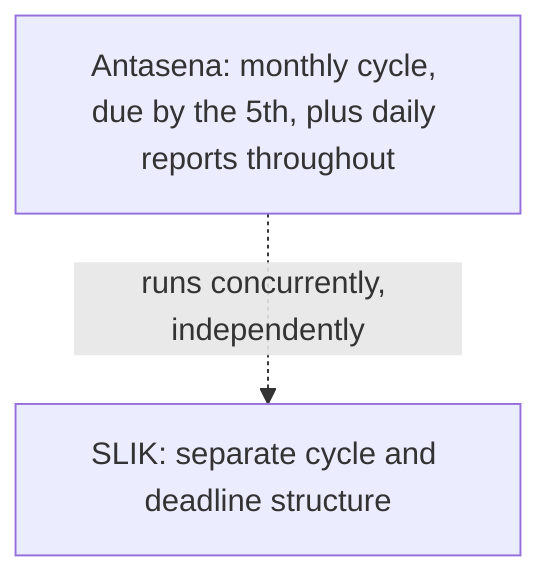
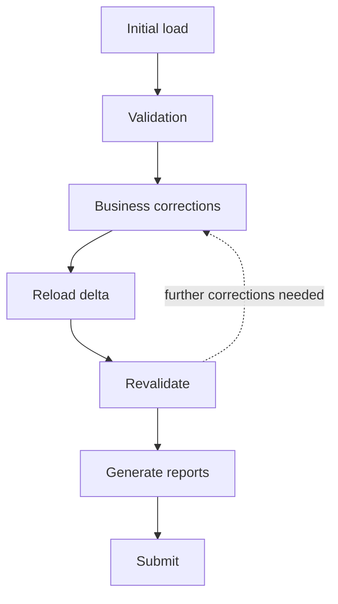

# Reporting Cycle

> Not one cadence — a different cadence and deadline per regulatory obligation.

---

# The Concept

A reporting cycle is the recurring cadence and deadline a bank must meet for a specific regulatory obligation. CRRS does not assume a single, bank-wide reporting cycle. Cadence and deadline are properties of the obligation, not the bank, and different obligations frequently run on different cycles at the same time.

Cadences observed across obligations include daily, weekly, monthly, quarterly, and annual — and a bank can be inside several of these simultaneously, for different reports, at any given moment.

---

# Cadence Varies by Obligation

Two obligations rarely share the same rhythm. For example:

- **Antasena** (Bank Indonesia) — reported monthly, with submissions due no later than the 5th of the following month. This deadline is fixed to the calendar date, not to a number of business days — if the 5th falls on a weekend, the deadline does not move. Antasena also has daily reporting requirements that continue in parallel with, and independently of, the monthly cycle.
- **SLIK** (OJK) — runs on its own separate cadence and deadline structure, distinct from Antasena.

Because deadlines like "the 5th of the month" are fixed calendar dates rather than relative offsets, and because failure to meet them (or submission of poor-quality data) can result in fines, the processing time available within a cycle is a hard constraint, not a target to aim for.

---

# Deliberately Staggered Cycles

Regulators do not always align different obligations' deadlines. In some cases, cycles for different obligations — such as Antasena and SLIK — are deliberately staggered by the regulator, rather than falling due at the same time.

This staggering exists to help ensure banks can give each report adequate attention rather than having to produce multiple reports under simultaneous deadline pressure, which risks lower report quality across the board. For CRRS, this means reporting cycles must be tracked and scheduled independently per obligation, not coordinated around a single shared calendar.

---

# Iterating Within a Cycle

Banks rarely complete a reporting cycle in a single pass. A typical cycle involves several iterations rather than one straight run from data acquisition to submission:

This loop is exactly where [Delta Processing](/products/crrs/concepts/delta-processing) and [Incremental Validation](/products/crrs/concepts/incremental-validation) matter operationally, not just at cycle boundaries: each "reload delta → revalidate" pass only needs to touch the corrected records, not the whole dataset, which is what makes repeated iterations within a tight deadline practical.

**Freeze point.** Once a cycle is ready for submission, CRRS treats the data as frozen: no further edits are accepted, the workflow is locked to prevent further state changes, and the audit trail for that cycle is finalized. This gives the submitted figures a clear, immutable boundary — what was submitted is exactly what was frozen, not a dataset that kept changing after the fact.

---

# Why This Matters for CRRS's Design

Because cadence, deadline structure, and staggering are all properties of the individual obligation:

- CRRS tracks reporting cycle state per obligation, not globally for the bank.
- Both the [Scheduler](/products/crrs/concepts/scheduler) (which runs Validate/Run against a calendar) and GoWFM's workflow coordination (see [CRRS Capabilities](/products/crrs/capabilities#workflow-management)) operate against each obligation's own calendar and deadline, including fixed calendar-date deadlines like "the 5th of the month" rather than relative day-counts.
- [Incremental Validation](/products/crrs/concepts/incremental-validation) and [Delta Processing](/products/crrs/concepts/delta-processing) apply within each obligation's own cycle boundary — a monthly obligation's delta is measured against its own previous monthly cycle, independently of a daily obligation running in parallel.

---

# Relationship to Other Concepts

- [Delta Processing](/products/crrs/concepts/delta-processing) and [Incremental Validation](/products/crrs/concepts/incremental-validation) — both operate within the boundary of a given obligation's reporting cycle.
- [Workflow](/products/crrs/concepts/workflow) and [Scheduler](/products/crrs/concepts/scheduler) — how GoWFM and the scheduler track and run activity against each obligation's cycle and deadline.

---

# Why It Matters

Getting a reporting cycle wrong isn't a quality issue in the abstract — it results in fines for late submission and reputational cost for poor-quality reporting, under deadlines that don't shift to accommodate processing delays. CRRS's design treats every obligation's cadence, deadline, and independence from other obligations as first-class facts to be tracked precisely, rather than approximated against a single bank-wide reporting calendar.
