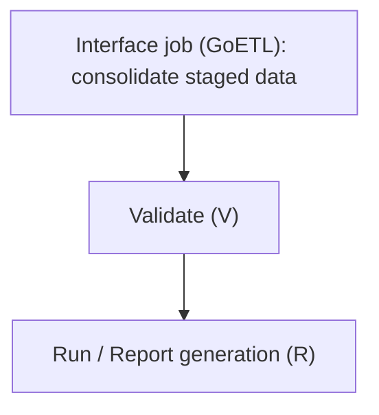

# Scheduler

> Deciding what runs, when, and in what order.

---

# Purpose

The scheduler is part of GoReport. It determines what should run, when, in what order, and how failures are retried — distinct from [Workflow](/products/crrs/concepts/workflow)'s human review states, which govern approval, not execution timing.

The same scheduler configuration also governs jobs unrelated to report processing itself — for example, periodic LDAP synchronization (see [CRRS Security](/products/crrs/security)) uses the same scheduling mechanism as report processing jobs.

---

# Job Types

The scheduler's primary role is automating Validate and Run across groups of report forms — a schedule defines when to run, and a Schedule Job attaches a set of report forms to that schedule. The same scheduling mechanism is also used for system jobs unrelated to report processing, such as LDAP synchronization.

---

# Dependencies

Jobs commonly depend on the completion of other jobs:

A downstream job starts only after its prerequisite jobs complete successfully. Combined with [Incremental Validation](/products/crrs/concepts/incremental-validation), this dependency chain only needs to re-run for the records actually affected by a delta, not the full pipeline each time.

---

# Scheduled vs. On-Demand

CRRS supports two triggering modes:

- **Scheduled** — triggered automatically against a calendar tied to each obligation's own [Reporting Cycle](/products/crrs/concepts/reporting-cycle) (e.g. daily, monthly, or ahead of a submission window).
- **On-demand** — triggered manually, typically for corrections, reprocessing, or testing.

---

# Queue Management and Priority

The scheduler maintains execution queues and can prioritize jobs by reporting deadline, job type, or explicit user request — relevant when multiple obligations with independently staggered deadlines (see [Reporting Cycle](/products/crrs/concepts/reporting-cycle)) are queued at the same time.

---

# Recovery

An interrupted job can resume from its last completed step rather than restarting the entire reporting cycle from scratch.

---

# Relationship to Other Concepts

- [Workflow](/products/crrs/concepts/workflow) — the scheduler triggers and sequences jobs; workflow tracks the human review and approval states those jobs feed into.
- [Reporting Cycle](/products/crrs/concepts/reporting-cycle) — scheduled jobs run against each obligation's own cadence and deadline.
- [Partitioning](/products/crrs/concepts/partitioning) — the scheduler's queued jobs execute across partitions in parallel (see Partitioning's "Parallel Processing" section).

---

# Why It Matters

Without an explicit scheduler, job sequencing and retries become manual or ad hoc — risky when multiple obligations with independent, fixed deadlines are in flight at once. The scheduler makes job dependency, prioritization, and recovery explicit and automatic.
