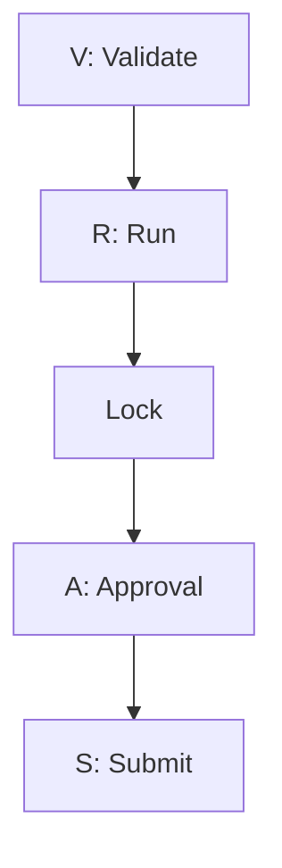
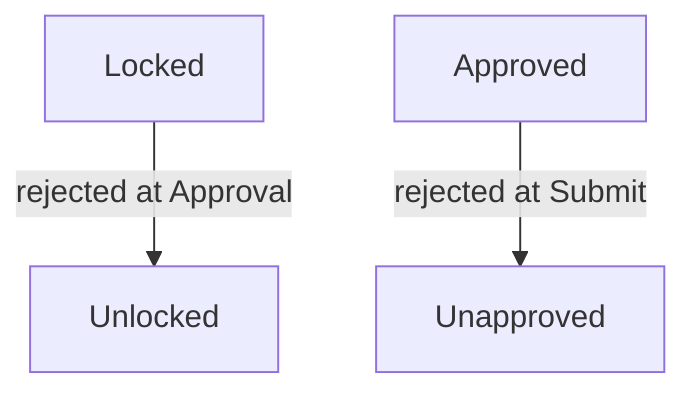

# Workflow

> Regulatory reporting is not simply data processing — people have to review, correct, and authorize it.

---

# Purpose

Regulatory reporting requires business users to review, approve, and authorize submissions, not just move data from source systems to a regulator. CRRS's workflow capability, provided by GoWFM, coordinates that human review process throughout the reporting lifecycle.

---

# Typical States

Every report form in CRRS progresses through a fixed sequence of stages, represented in the UI as five icons: **V** (Validate) → **R** (Run) → **Lock** → **A** (Approval) → **S** (Submit).

Validate and Run can be executed per form or automated across many forms on a schedule (see [Scheduler](/products/crrs/concepts/scheduler)). Lock, Approval, and Submit can each be executed on a single form or, via a Workflow Group, across all of a bank's branches at once. Every run of Validate/Run produces a new, separately retained version of the report; only the most recently generated version can be locked.

---

# Roles

CRRS's workflow enforces segregation of duties through access levels assigned per user (via User Groups), rather than a fixed org chart:

- **Maker** — enters and runs data, and corrects it when validation fails, but cannot approve or submit.
- **Checker** — reviews and validates the Maker's output; can lock a form, approve it, and (depending on configuration) submit it.
- **Submitter** — submits a form that has completed approval; in practice, submission authority is configured per bank and may sit with the Checker or a separate Submitter access level.
- **Admin** — full access, including form configuration, user and User Group management, and system settings.

---

# Rework

Not every report passes review on the first attempt. Rather than starting over, a rejection reverts the form to the stage before the one it was rejected from:

A form rejected during Approval reverts to an unlocked state; a form rejected during Submit reverts to an unapproved state. Either way, the Maker corrects the flagged data and the form re-enters the V → R → Lock → Approval → Submit sequence from wherever it reverted to — it does not restart from Validate. This is where [Incremental Validation](/products/crrs/concepts/incremental-validation) matters operationally: a rejection that leads to correcting a handful of rows only requires revalidating those rows, not the entire dataset, before it can move back toward approval.

---

# Audit Trail

Every workflow action is recorded, capturing:

- The user who performed it.
- The timestamp it occurred at.
- The action taken (e.g. approved, rejected, corrected).
- Any comments attached to the action.

This workflow history, combined with [Data Lineage](/products/crrs/concepts/lineage), forms the complete audit trail for a submitted report — not just what the final figures were, but who reviewed them, what was changed, and why.

---

# Relationship to Other Concepts

- [Reporting Cycle](/products/crrs/concepts/reporting-cycle) — workflow states track progress through each obligation's own cycle, including the freeze point before submission.
- [Incremental Validation](/products/crrs/concepts/incremental-validation) — rework after a rejection only revalidates what was corrected.
- [Data Lineage](/products/crrs/concepts/lineage) — workflow history complements lineage to form the complete audit trail.

---

# Why It Matters

Without an explicit workflow, review and approval happen informally — over email, spreadsheets, or verbal sign-off — with no reliable record of who approved what, or why a correction was made. CRRS's workflow makes that review process, and its history, a first-class part of the platform rather than something that happens around it.
