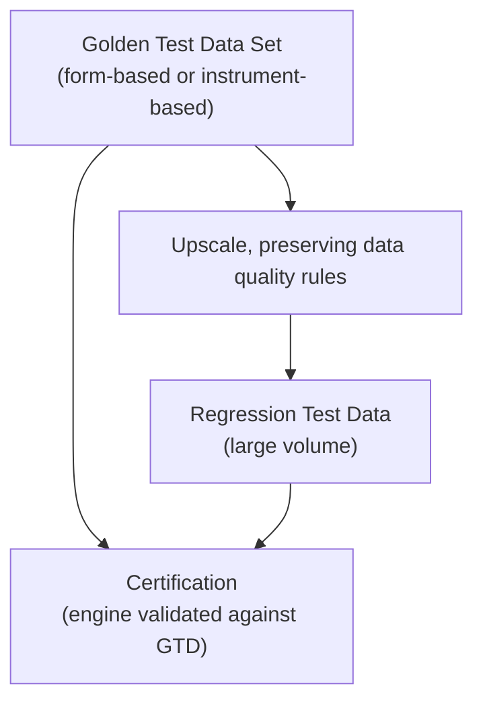
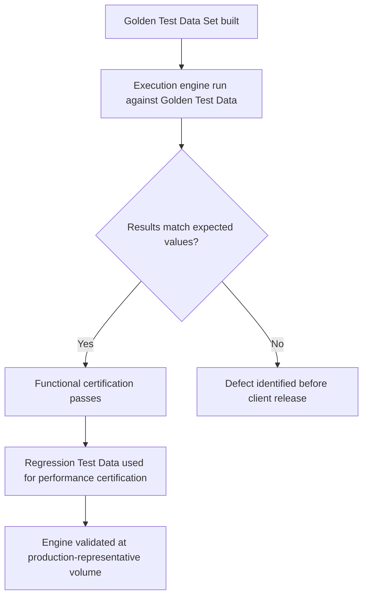

# CRTP Architecture

> How CRTP builds and applies Golden Test Data, Certification, and Regression Test Data.

---

# Core Components

**Golden Test Data Set** — a small, curated, known-correct dataset, built either form-based (directly from a regulatory data requirement) or instrument-based (banking-instrument source data populated into RRDF).

**Certification** — the process of validating an application or execution engine against a Golden Test Data Set, confirming it produces correct, expected results before it is released for use by a banking client.

**Regression Test Data** — Golden Test Data upscaled in volume (for example, 100 rows to 10,000,000 rows) for performance testing, while every row continues to satisfy the same data quality rules the Golden Test Data was built to (mandatory fields populated, unique keys, and so on).

---

# How Certification Uses Golden and Regression Test Data

Functional correctness is certified against Golden Test Data first, at small scale. Performance and scale behavior is certified separately, against Regression Test Data, once functional correctness is established.

---

# What This Deliberately Does Not Include

CRTP's architecture does not include point-and-click UI automation (of the kind produced by tools like Katalon or Leapwork) for driving an execution engine's application layer. See [CRTP](/products/crtp#what-crtp-deliberately-excludes) for the reasoning: UI automation scripts are specific to one execution engine's interface and don't transfer to another, so they don't produce reusable platform capability the way engine-agnostic test data does.

---

# Design Goals

- **Engine-agnostic** — Golden Test Data, Certification, and Regression Test Data all apply regardless of which execution engine is under test.
- **Reusable** — the same Golden Test Data Set supports both functional certification and, once upscaled, performance certification.
- **Quality-preserving at scale** — upscaling for Regression Test Data never relaxes the data quality rules the Golden Test Data was built to.
- **Traceable** — Golden Test Data is traceable back to the regulatory data requirement or instrument definition it was built from.

---

# Related Documentation

- [CRTP](/products/crtp) — product overview.
- [Execution Layer](/platform/execution-layer) — the architectural role CRTP shares with CDAP.
