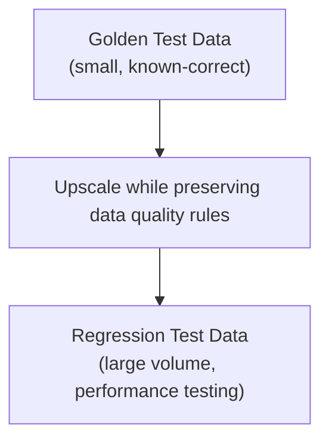
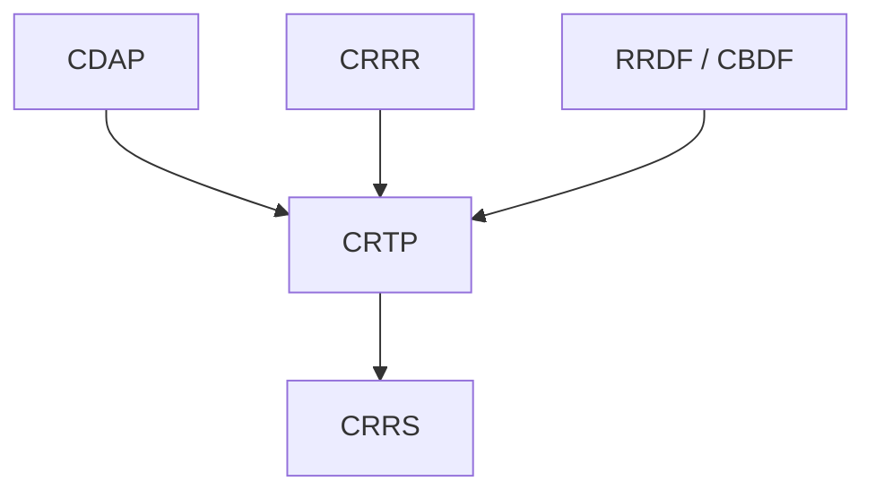

# Compliance Regression Testing Platform (CRTP)

> Known-good data and known-good engines, re-verified automatically.

CRTP is the platform component responsible for test data and quality certification across the regulatory reporting lifecycle. It provides the data and process discipline needed to prove that an implementation is correct before it reaches a banking client, and that it stays correct as regulations, models, and execution technology change.

CRTP is deliberately scoped around three concrete capabilities rather than being a generic testing framework: Golden Test Data Sets, Certification, and Regression Test Data.

---

# What CRTP Provides

- **Golden Test Data Sets** — curated, known-correct datasets used as the baseline for functional testing, built either form-based (directly from the regulatory data requirement) or instrument-based (banking-instrument source data populating RRDF).
- **Certification** — a quality gate that validates each application or execution engine meets the bar required for release to banking clients before it goes into production.
- **Regression Test Data** — large-volume datasets, upscaled from Golden Test Data, used to performance-test an implementation while still adhering to the same data quality requirements.

---

# Golden Test Data Sets

A Golden Test Data Set is a small, curated dataset known to be correct — the baseline every functional test is measured against.

CRTP supports two forms:

- **Form-based** — test data structured directly around a regulatory data requirement (the fields and structure a specific report or submission requires).
- **Instrument-based** — banking-instrument-level source test data, populated into RRDF's canonical model, that exercises the full acquisition-to-reporting pipeline rather than a single form in isolation.

---

# Certification

Certification is CRTP's quality gate for execution engines. Before an application or execution engine — whether a CygnetONE component like GoDQ, or a third-party engine plugged into CDAP — is released for use by a banking client, CRTP validates it against Golden Test Data to confirm it produces correct, expected results.

This gives clients confidence that an execution engine has been proven against known-correct data before it is relied upon in production, rather than being trusted on the vendor's word alone.

---

# Regression Test Data

Regression Test Data extends Golden Test Data for performance testing. It is a large collection of raw data, still compliant with the same data quality requirements as the Golden Test Data it's derived from — mandatory fields populated, account numbers unique, and so on — but scaled up in volume.

For example, 100 rows of functional test data can be upscaled to 10,000,000 rows for performance testing, while every row still satisfies the underlying data quality rules.

---

# What CRTP Deliberately Excludes

CRTP does not provide point-and-click UI automation scripts (of the kind produced by tools like Katalon or Leapwork) for testing an execution engine's application layer.

Each execution engine has its own UI, with its own click sequences and element positions. A UI automation script built for one engine's product does not transfer to another's — building one for Regnology does not help when the client uses AxiomSL, or vice versa. Investing there would mean building a new, disposable script for every client and every execution engine, rather than reusable capability.

CRTP's value is deliberately built around what *is* reusable across execution engines: Golden Test Data, Certification, and Regression Test Data are all engine-agnostic — the same data and certification process can be applied regardless of which execution engine a client uses. That reusability is what compounds into platform value over time; per-client UI scripting does not.

---

# Relationship to Other Products

- **Depends on:** CRRR, RRDF, and CBDF for the knowledge and models that define expected behavior, and CDAP for the execution services it verifies.
- **Works alongside:** CDAP, whose validation, transformation, and workflow behavior CRTP continuously verifies.
- **Used by:** CRRS, which relies on CRTP to verify reporting behavior as regulations and integrations evolve.

See [CRTP Architecture](/products/crtp/architecture) for how this verification process is structured.

---

# Why It Matters

Without known-correct test data and a certification process, every implementation and every execution engine has to earn client trust from scratch, on a case-by-case basis, and every regulatory update carries a hidden cost: someone has to manually re-verify that nothing broke.

CRTP keeps both costs down by building around reusable, engine-agnostic assets — Golden Test Data, Certification, and Regression Test Data — rather than one-off, per-client, per-engine testing effort.

---

# Related Documentation

- [CRTP Architecture](/products/crtp/architecture) — a deeper look at how CRTP verifies behavior.
- [Execution Layer](/platform/execution-layer) — the architectural role CRTP shares with CDAP.
- [CDAP](/products/cdap) — the execution services CRTP verifies.
