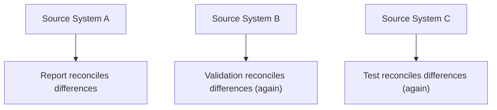
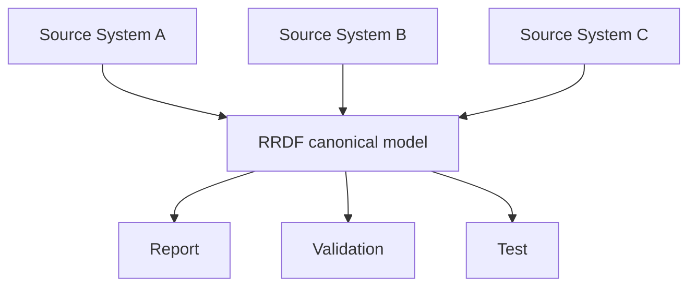
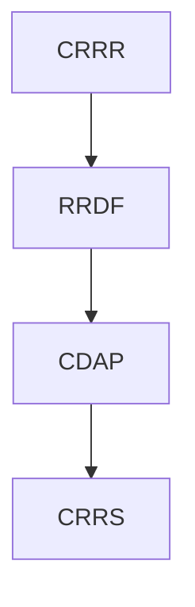

# Regulatory Reporting Data Foundation (RRDF)

> One definition of the data behind every regulatory report.

RRDF is the platform component that implements the CygnetONE Information Layer for regulatory reporting.

It defines the canonical information model required to produce regulatory reports: the entities, attributes, and relationships that reporting obligations reference — modeled independently of any single operational source system.

---

# The Problem RRDF Solves

Every bank runs multiple core systems, each with its own way of representing the same underlying concept. A "customer," a "facility," or an "exposure" may be structured differently in three different source systems.

Without a canonical model, every report, every validation rule, and every test has to independently reconcile those differences — and that reconciliation logic gets duplicated everywhere it's needed.

**Without RRDF** — every consumer reconciles source-system differences on its own:

**With RRDF** — every consumer reads from one canonical model instead:

RRDF removes that duplication by defining the canonical shape of regulatory reporting data once.

---

# What RRDF Provides

- Canonical entities, attributes, and relationships for regulatory reporting
- A stable data model independent of operational source-system schemas
- A shared vocabulary that reporting, validation, and testing all build on
- Traceable definitions back to the regulatory concepts captured in CRRR

RRDF does not invent its own definitions — it implements, in structured data-model form, the business concepts and terminology already captured in CRRR.

---

# Design Principles

RRDF's canonical models are built to be:

- **Source-independent** — modeled around the business concept, not around any one operational system's schema.
- **Stable** — designed to change only when the underlying regulatory or business concept changes, not when a source system is replaced.
- **Explicit** — every attribute has a traceable definition back to CRRR.
- **Reusable** — the same model serves reporting, validation, analytics, and integration without modification.

---

# Relationship to Other Products

- **Depends on:** CRRR, for the concepts and terminology it models.
- **Extended by:** CBDF, which broadens the canonical model beyond regulatory reporting to enterprise-wide banking data.
- **Consumed by:** CDAP and CRTP, whose services operate against RRDF's canonical models rather than raw source-system data.
- **Used by:** CRRS, which is built directly on top of RRDF.

---

# Why It Matters

Without a canonical reporting data model, every new report or regulatory change requires re-deriving an understanding of the underlying data from scratch — repeating work already done elsewhere in the organization, and risking that different teams define the same concept differently.

With RRDF, the organization has one place where "what does this reporting data mean" is answered — consistently, for every consumer, for as long as the platform is in use.

---

# Related Documentation

- [Information Layer](/platform/information-layer) — the architectural role RRDF implements.
- [CBDF](/products/cbdf) — the broader banking data model RRDF's approach extends into.
- [CRRS](/products/crrs) — a solution built directly on RRDF.
